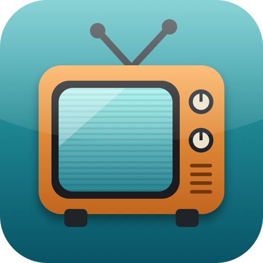
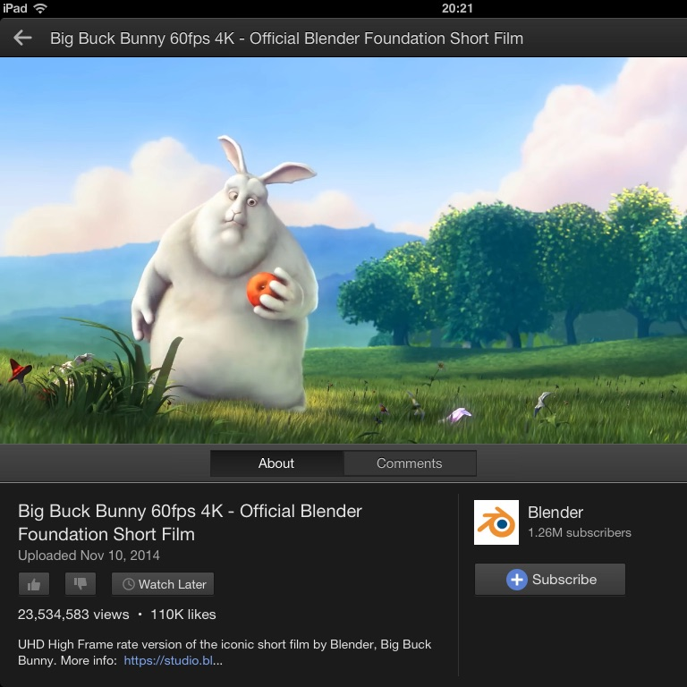
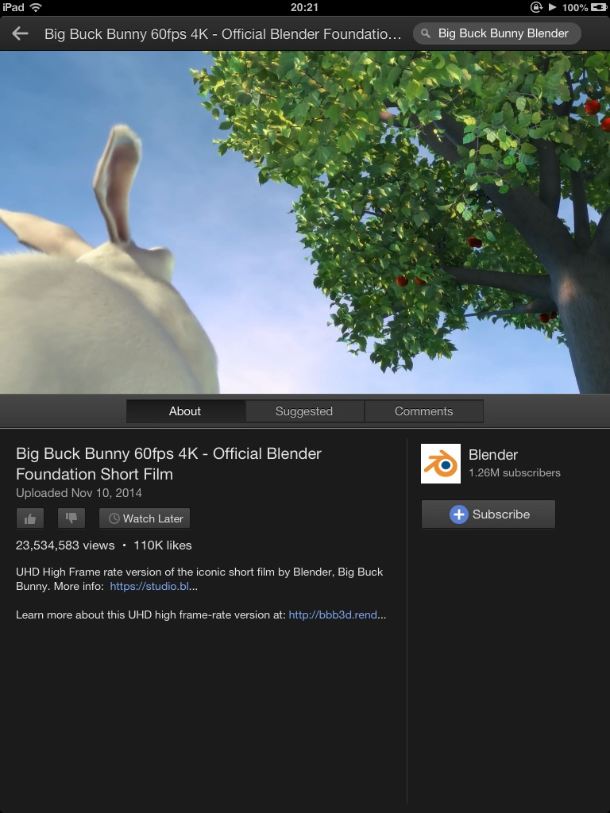

<p align="center"></p>

<h1 align="center">PadTube</h1>
<p align="center"><b>YouTube on an iPad of 2012, on iOS 6.</b><br>A native app in the style of the iOS 6 era, written new in C and Objective-C. Fast on an iPad mini 1 with 512 MB of RAM.</p>
<p align="center">No server of ours. No ads SDK. No telemetry. The app talks to YouTube directly from your iPad.</p>

<p align="center"> <br><sub>Real screenshots from an iPad mini 1 on iOS 6.1.3. Film: <i>Big Buck Bunny</i> © Blender Foundation, CC BY 3.0.</sub></p>

<p align="center">Tried it on your iPad? Send a <a href="../../issues/new?template=device-report.yml">device report</a>. A ⭐ helps other old-iPad owners find it.</p>

| | |
|---|---|
| **Install** | [Install guide](docs/install/README.md). Not jailbroken? [Step-by-step guide](docs/install/non-jailbroken-ipad.md) |
| **Supports** | iPad on **iOS 6 and later**: 32-bit code for iPad 2, 3, 4 and mini 1 (iOS 6 to 10), 64-bit code for later iPads (iOS 7 and later) |
| **Tested** | ✅ iPad mini 1, iOS 6.1.3 (jailbroken): the speed gates below, measured on the device. A script drives the screen in these tests |
| **Experimental** | ⚠️ The 64-bit code, every iOS other than 6.1.3, the rootless package and the sideload steps: **built and checked on a Mac, never run on a device.** Please send a [device report](../../issues/new?template=device-report.yml) |
| **Security** | [SECURITY.md](SECURITY.md): what the app stores, known limits, how to report a problem |

**PadTube is not affiliated with, endorsed by or sponsored by Google or YouTube.** YouTube is a trademark of Google LLC. PadTube uses its own name, icon and wordmark, and shows no YouTube logo.

## What it does

| Feature | Detail |
|---------|--------|
| Browse | Home, search with suggestions, channels, playlists, related videos, comments; your history and searches stay on the iPad |
| Play | Up to 720p H.264 + AAC through iOS's own player; quality menu; captions (manual and auto-generated); live streams; background audio and the lock screen |
| Sign in (optional) | With a short code: PadTube shows the code, you enter it at google.com/device on another device. No password and no web page on the iPad. Then Home, Subscriptions, History, Watch Later, Liked Videos and Playlists show your account |
| Look | The iPad style of 2012: dark header, guide on the left, card grid. Light and Dark theme |
| Links | YouTube links open in PadTube; other links open in Safari |
| Shorts | A vertical swipe feed with the next Short ready before the swipe ends; like, comments, subscribe, share; reload |
| Signed-in playback | When YouTube asks to confirm you are not a bot, PadTube plays through your account: it runs YouTube's player challenge in iOS 6's own JavaScriptCore (prepared once per YouTube player version, about 4 s on an iPad mini 1) |
| Gestures | Swipe from the left edge to go back; in full screen, swipe down to leave it; double tap the left or right side of the video for -10 / +10 s; swipe across the area under the tabs to change the tab |

Not in this version: uploads, downloads, a comment box, playback speed, iPhone layout.

## Speed on an iPad mini 1 (A5, 512 MB, iOS 6.1.3)

| Gate | Target | Measured |
|---|---|---|
| Grid scroll, both orientations, Light and Dark | ≥ 55 fps | 59.0 to 60.0 fps |
| Search result on screen | ≤ 1.2 s | 0.45 to 0.76 s |
| Video start at 720p, tap to first frame | ≤ 2.5 s | 0.47 to 2.28 s, also for videos of one hour |
| Memory, steady / peak | ≤ 120 / ≤ 180 MB | 25 to 51 MB / 36 to 60 MB |
| Picture back after a return from the background | ≤ 2 s | 0.92 to 1.87 s |
| Main thread stall, steady playback and scroll | ≤ 50 ms | 6 ms in playback; most scroll frames under 36 ms |

**Known limits on the iPad mini 1:** iOS's own player blocks the main thread for 177 to 326 ms when a video starts, and for up to 100 ms at a seek; a scroll can show a single slow frame (up to 101 ms). Both come from Apple's code or a jailbreak tweak, measured with a stall sampler. A far seek takes 1.3 to 4.4 s.

How: the app has its own HTTP/TLS client on OpenSSL 3.5.9 with a connection pool, parses YouTube's answers in C (yyjson), turns the video and audio streams into a small HLS stream on 127.0.0.1 for iOS's player, and draws the grid off the main thread. Design documents: [requirements](docs/business/requirements/padtube.md), [architecture](docs/architecture/domains/padtube-core.md), [decisions](docs/decisions.md).

## Build (macOS, Apple Silicon, Command Line Tools only)

```sh
# theos and its SDKs (the 9.3 SDK for armv7, the 16.5 SDK for arm64)
git clone --recursive https://github.com/theos/theos ~/theos
git clone https://github.com/theos/sdks /tmp/sdks && cp -R /tmp/sdks/iPhoneOS9.3.sdk /tmp/sdks/iPhoneOS16.5.sdk ~/theos/sdks/
brew install dpkg make ldid
scripts/make_ios_sdk.sh      # a copy of the 9.3 SDK that today's linker accepts for armv7
scripts/build_deps.sh        # OpenSSL 3.5.9 for armv7, arm64 and the Mac (SHA-256 checked)
scripts/package_all.sh       # the release files in dist/
```

All armv7 code builds with `-mno-thumb`: today's linker writes code pointers without the Thumb bit, and Thumb code then crashes on the device. `scripts/check_ios_binary.py` fails a build that has a Thumb function, an API newer than iOS 6, or test code.

## Tests

```sh
scripts/run_tests.sh   # unit tests (parsers against recorded answers, media, store), e2e against YouTube, binary checks
```

On the iPad (USB, no root): `tests/device/*.py` drive a `SELFTEST=1` build through a control port on 127.0.0.1 and take screenshots. A script drives the screen: no finger test. `scripts/check_release.py` is the release gate: no key, token, local path, private file or third-party logo.

## Layout

```
core/      C: HTTP/TLS client, YouTube parsers, stream remux, local HLS server, store
ios/       theos app (Objective-C, iOS 6 API only); ios/selftest/ only in SELFTEST=1 test builds
tools/     icon and launch image drawing, USB helpers (ptlaunch, ptmount)
tests/     host/ unit tests, e2e/ against YouTube, device/ on the iPad, fixtures/ recorded answers
scripts/   build, packages, release gate, test runner
```

## Licences

| Part | Licence |
|------|---------|
| PadTube | MIT ([LICENSE](LICENSE)) |
| OpenSSL 3.5.9 | Apache-2.0 |
| yyjson | MIT |
| QR Code generator (Nayuki) | MIT |

The licence texts are in [third_party/vendor](third_party/vendor) and in the app (Licenses folder). See [NOTICE](NOTICE).

Video and channel content belongs to its owners. Using YouTube through PadTube is subject to YouTube's own terms.
