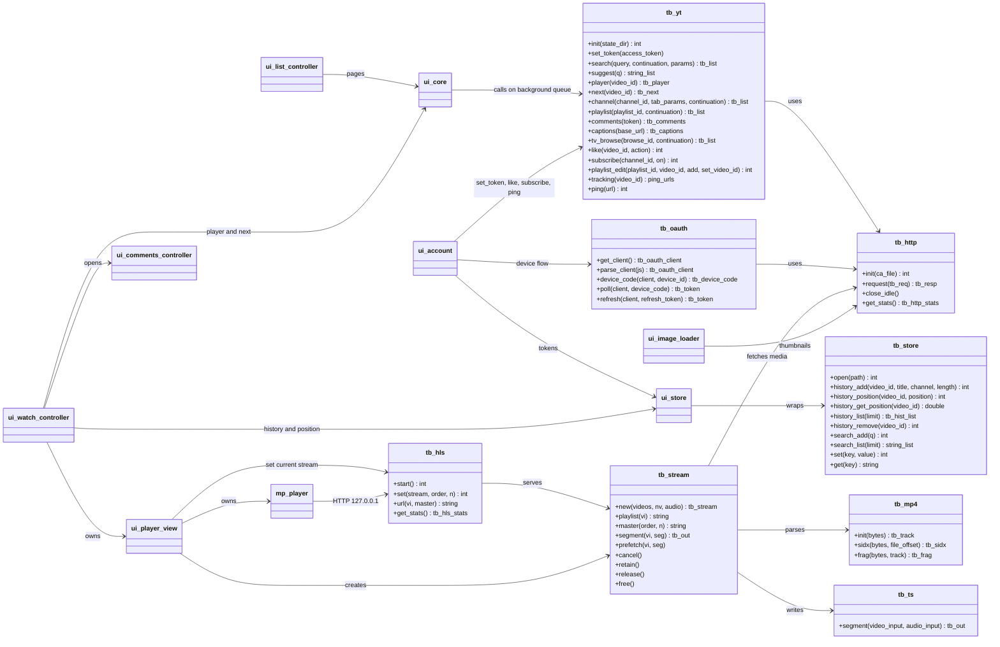
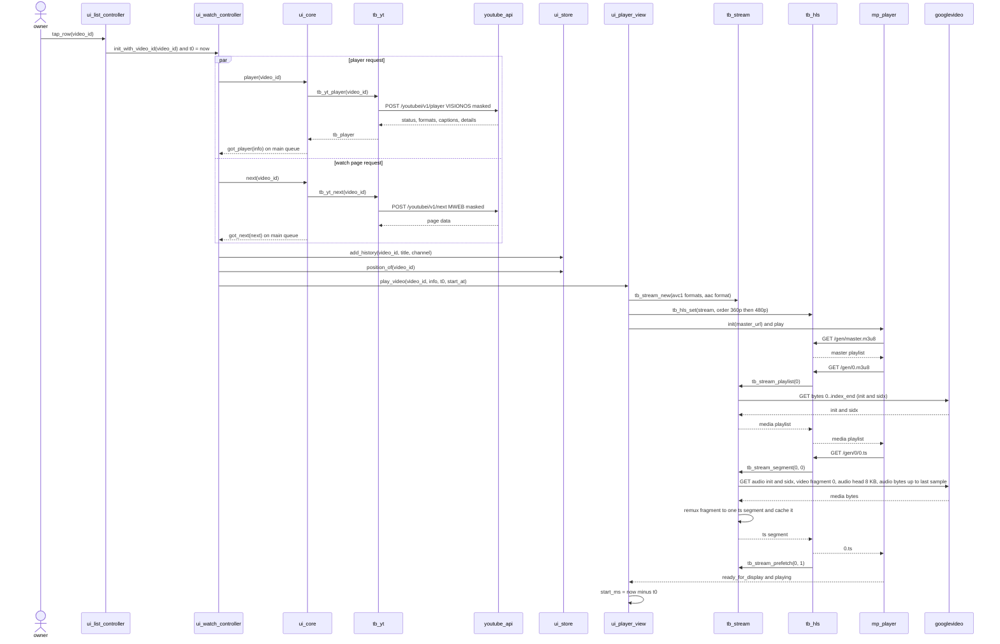
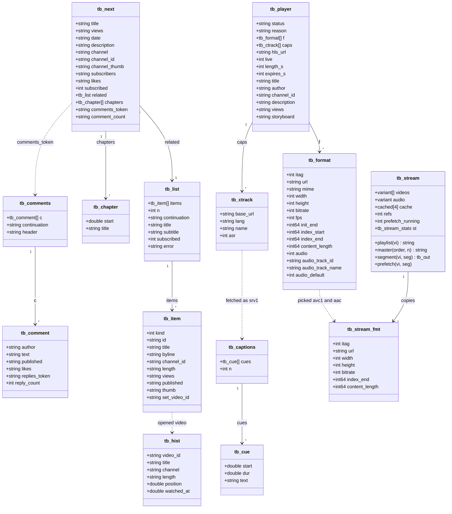

# PadTube Core Domain

**Version:** 1.0 · **Date:** 2026-11-11 · **Status:** Approved (owner, 2026-11-11)

This document describes the components of PadTube and their data model. It describes the code that exists in `core/` and `ios/src/` (Phase 0 spike, [D4](../../decisions.md)). The use cases give the behavior: [BUC-WATCH-A-VIDEO](../../use_cases/business/watch-a-video.md), [BUC-SIGN-IN-WITH-CODE](../../use_cases/business/sign-in-with-code.md) and the DUCs under [docs/use_cases/domain/](../../use_cases/domain/).

PadTube is one app on one iPad. There are no services and no API between services. The bounded contexts below are modules in one process with a C API between them.

---

## 1. Bounded Contexts

| Context | Code | Responsibility | Use cases |
|---------|------|----------------|-----------|
| **net** | `core/tb_http.*` | HTTPS / HTTP client on OpenSSL; keep-alive pool per host; gzip; chunked; redirects; Range; cancel flag; counters. Blocking and thread safe. | all |
| **json** | `core/tb_json.*` + yyjson | Path helpers on yyjson; InnerTube text (`simpleText`, `runs`) to C string. | all |
| **innertube** | `core/tb_yt.*` | InnerTube client: MWEB for lists, VISIONOS for playback, TVHTML5 + token for the account. Visitor ID cache. Field masks. Parsers for lists, player, next, comments, captions. | [search](../../use_cases/domain/search/search.md), [playback](../../use_cases/domain/playback/start.md), [captions](../../use_cases/domain/captions/show.md), [library](../../use_cases/domain/library/browse.md), [video page](../../use_cases/domain/video-page/load.md), [history](../../use_cases/domain/history/record.md) |
| **stream / remux** | `core/tb_mp4.*`, `core/tb_ts.*`, `core/tb_stream.*` | fMP4 reader (init, sidx, one fragment); MPEG-TS writer (H.264 Annex B + AAC ADTS); one playback = DASH formats → HLS playlists and TS segments, 1 fragment = 1 segment; segment cache; one background prefetch. | [playback](../../use_cases/domain/playback/start.md) |
| **hls server** | `core/tb_hls.*` | HTTP server on 127.0.0.1 for the iOS player; serves the current stream by generation; refcount per request; never blocks the caller. | [playback](../../use_cases/domain/playback/start.md) |
| **store** | `core/tb_store.*` | SQLite 3.7.13 in WAL mode: watch history with resume position, recent searches, key/value settings. One mutex; one transaction per action. | [history](../../use_cases/domain/history/record.md), [search](../../use_cases/domain/search/search.md), [sign-in](../../use_cases/domain/account/sign-in.md) |
| **oauth** | `core/tb_oauth.*` | Google OAuth 2.0 device flow with the TV client ID from the TV `base.js`; poll; refresh. | [sign-in](../../use_cases/domain/account/sign-in.md) |
| **Objective-C layer** | `ios/src/*` | Thin UIKit layer: wrappers that run the C calls on a background queue and call back on the main queue; screens; player view; captions label; image loader; theme. | all |

### Name map (diagram name → code)

The diagrams use snake_case names. The Objective-C classes map as below.

| Diagram name | Code |
|--------------|------|
| `ui_core` | `TBCore` (+ `TBItem`, `TBPage`, `TBPlayerInfo`, `TBNextInfo`, `TBFormat`, `TBCaptionTrack`, `TBCue`) |
| `ui_account` | `TBAccount` |
| `ui_store` | `TBStore` |
| `ui_list_controller` | `TBListController` (+ `TBRouter`), `TBSearchController`, `TBLibraryController` |
| `ui_watch_controller` | `TBWatchController` |
| `ui_player_view` | `TBPlayerView` |
| `ui_comments_controller` | `TBCommentsController` |
| `ui_image_loader` | `TBImageLoader` |
| `mp_player` | `MPMoviePlayerController` (iOS) |

---

## 2. Component Class Diagram

### Component rules

| Rule | Description | Source |
|------|-------------|--------|
| Threads | `ui_core` runs every network call on the concurrent queue `padtube.net` and calls back on the main queue. The HLS server serves each request on its own thread. `tb_stream_prefetch` runs on its own thread. | `ios/src/TBCore.m`, `core/tb_hls.c`, `core/tb_stream.c` |
| One current stream | `tb_hls_set` makes one stream current and increments the generation. A request for an old generation gets 404. The server holds one reference per request; `tb_hls_set` never blocks. | BR-PLAY-ONE, [D12](../../decisions.md) |
| Client per call | MWEB: search, next, comments, channel, playlist, visitor ID. VISIONOS: player. TVHTML5 + Bearer: TV browse, like, subscribe, playlist edit, tracking. | BR-LOGIN-TV, [research-features §2 F1, F6](../../research/research-features.md#2-facts-for-2026-that-set-the-design) |
| Masks | Field masks on search, player and next, with a no-mask fallback for search and next. | BR-NET-MASK, [D10, D15](../../decisions.md) |
| Connections | One keep-alive pool per host. iOS 6 has no TLS session tickets, so connection reuse is necessary. `tb_http_close_idle` drops idle connections on a memory warning. | [research-efficiency §6](../../research/research-efficiency.md#6-network) |
| Memory warning | Clear the image RAM cache and close idle connections. | `ios/src/TBAppDelegate.m` |
| Background audio | AVAudioSession category Playback, `UIBackgroundModes=audio`, remote-control events, `MPNowPlayingInfoCenter`. The process and the local server stay alive while audio plays. | [research-features §4.2](../../research/research-features.md#42-background-audio) |

---

## 3. Sequence: Tap Video → First Frame

---

## 4. Data Model

All strings are `malloc` C strings owned by the struct. Each struct has a free function (`tb_list_free`, `tb_player_free`, `tb_next_free`, `tb_comments_free`, `tb_captions_free`, `tb_hist_free`). The Objective-C layer copies the fields into `TBItem`, `TBPage`, `TBPlayerInfo`, `TBNextInfo` and frees the C struct at once.

---

## tb_item

One row of any list (search, feed, channel, playlist, related).

### Attributes

| Attribute | Type | Required | Description |
|-----------|------|----------|-------------|
| kind | int | Yes | 1 video, 2 channel, 3 playlist, 4 live, 5 shelf |
| id | string | Yes | Video ID (11 characters), channel ID (`UC…`) or playlist ID |
| title | string | Yes | Title |
| byline | string | No | Channel name |
| channel_id | string | No | Channel ID of a video |
| length | string | No | Display length, for example "3:25" |
| views | string | No | View text, or subscriber text for a channel |
| published | string | No | Relative date, for example "1 year ago" |
| thumb | string | No | Image URL; `mqdefault.jpg` for videos (BR-SEARCH-THUMB) |
| set_video_id | string | No | Playlist item ID, used to remove the item (BR-LIB-SETID) |

---

## tb_list

One page of items.

### Attributes

| Attribute | Type | Required | Description |
|-----------|------|----------|-------------|
| items, n, cap | tb_item[], int, int | Yes | Items on this page |
| continuation | string | No | Token for the next page; NULL at the end |
| title, subtitle | string | No | Page title (channel, playlist) |
| subscribed | int | No | Channel pages: -1 unknown, 0, 1 |
| error | string | No | Error text for the UI |

### Methods

| Method | Parameters | Returns | Description |
|--------|------------|---------|-------------|
| tb_yt_search | query, continuation, params | tb_list | MWEB search, masked ([DUC-SEARCH-SEARCH](../../use_cases/domain/search/search.md)) |
| tb_yt_channel | channel_id, tab_params, continuation | tb_list | MWEB channel page |
| tb_yt_playlist | playlist_id, continuation | tb_list | MWEB playlist page |
| tb_yt_tv_browse | browse_id, continuation | tb_list | TVHTML5 + token ([DUC-LIB-BROWSE](../../use_cases/domain/library/browse.md)) |
| tb_list_free | — | void | Frees all strings and items |

---

## tb_player

The VISIONOS player answer: playability, formats, caption tracks, details.

### Attributes

| Attribute | Type | Required | Description |
|-----------|------|----------|-------------|
| status, reason | string | Yes | `OK`, `LOGIN_REQUIRED`, `UNPLAYABLE`, `ERROR`, …; reason text |
| f, nf | tb_format[], int | Yes | Adaptive formats with plain URLs (no cipher, no `n=`) |
| caps, ncaps | tb_ctrack[], int | No | Caption tracks; `asr` = auto-generated |
| hls_url | string | No | HLS manifest (live) |
| live | int | No | 1 for a live stream |
| length_s | int | Yes | Length in seconds |
| expires_s | int | No | Lifetime of the media URLs |
| title, author, channel_id, description, views, storyboard | string | No | Video details |

### tb_format

| Attribute | Type | Description |
|-----------|------|-------------|
| itag, mime | int, string | Format ID and MIME with codecs |
| url | string | googlevideo URL |
| width, height, bitrate, fps | int | Video properties |
| init_end, index_start, index_end, content_length | int64 | Byte ranges of init, sidx and the file |
| audio, audio_track_id, audio_track_name, audio_default | int, string, string, int | Audio flag and track (dubbed tracks) |

### Business Rules

| Rule | Description | Enforcement |
|------|-------------|-------------|
| BR-PLAY-FORMAT | Keep avc1 ≤ 720 (one per height, lowest bitrate) and mp4a.40.2 (default track) | `ui_core` player wrapper |
| EF-PLAY-1 | `LOGIN_REQUIRED` on the first try: new visitor ID, retry once | `tb_yt_player` |

---

## tb_captions

Cues of one caption track (`fmt=srv1`).

| Attribute | Type | Description |
|-----------|------|-------------|
| cues, n | tb_cue[], int | `start` and `dur` in seconds; `text` unescaped |

Method: `tb_yt_captions(base_url)` ([DUC-CAP-SHOW](../../use_cases/domain/captions/show.md)).

---

## tb_next

The MWEB `next` answer for the watch page.

### Attributes

| Attribute | Type | Required | Description |
|-----------|------|----------|-------------|
| title, views, date, description | string | Yes | Video text |
| channel, channel_id, channel_thumb, subscribers | string | Yes | Channel line |
| likes | string | No | Like count text |
| subscribed | int | No | -1 unknown, 0, 1 |
| related | tb_list | No | Related videos |
| chapters, nchapters | tb_chapter[], int | No | `start` (s), `title` |
| comments_token, comment_count | string | No | Token for `tb_yt_comments`; count text |

Method: `tb_yt_next(video_id)` ([DUC-VPAGE-LOAD](../../use_cases/domain/video-page/load.md)).

---

## tb_comments

| Attribute | Type | Description |
|-----------|------|-------------|
| c, n | tb_comment[], int | `author`, `text`, `published`, `likes`, `replies_token`, `reply_count` |
| continuation | string | Next page |
| header | string | For example "1.2K Comments" |

Method: `tb_yt_comments(token)`; loaded on tap only (BR-VPAGE-COMMENTS).

---

## tb_stream

One playback: DASH avc1 + AAC formats → HLS playlists and MPEG-TS segments. Opaque in `core/tb_stream.h`; the fields below are the internal state in `core/tb_stream.c`.

### Attributes

| Attribute | Type | Required | Description |
|-----------|------|----------|-------------|
| videos[] (variant) | tb_stream_fmt + tb_track + tb_sidx + ready | Yes | One per video format; init and sidx fetched on first use |
| audio (variant) | same | Yes | The AAC format |
| audio fragment buffer | idx, bytes, tb_frag | — | First 8 KB (moof), then bytes up to the needed sample ([D6](../../decisions.md)) |
| cache[4] | (vi, seg, TS bytes, use) | — | LRU of remuxed segments (BR-PLAY-CACHE) |
| refs | int | — | Owner + one per HLS request |
| prefetch_running, pf_vi, pf_seg, cancel | int | — | One background prefetch; a request for another segment cancels it |
| st | tb_stream_stats | — | segments_built, cache_hits, last_build_ms, last_fetch_ms, last_remux_ms, remux_ms_total, media_s_total, bytes_fetched, last_status |

### Methods

| Method | Parameters | Returns | Description |
|--------|------------|---------|-------------|
| tb_stream_new | videos, nv, audio | tb_stream | Copies the formats; no download |
| tb_stream_playlist | vi (-1 = audio only) | string | Media playlist; one `#EXTINF` per sidx entry |
| tb_stream_master | order, n | string | Master playlist; first variant = start variant |
| tb_stream_segment | vi, seg | tb_out | Cached or built TS segment |
| tb_stream_prefetch | vi, seg | void | Build the next segment in the background |
| tb_stream_cancel / tb_stream_free | — | void | Stop downloads / drop the owner reference |

### Business Rules

| Rule | Description | Enforcement |
|------|-------------|-------------|
| BR-PLAY-REMUX | 1 fragment = 1 TS segment; audio by DTS; segment 0 from minus infinity ([D5](../../decisions.md)) | `build` |
| BR-PLAY-CACHE | ≤ 4 segments; one prefetch at a time | `get_locked`, `tb_stream_prefetch` |
| BR-PLAY-START | Auto order 360p, 480p | `ui_player_view` → `tb_hls_set` |

---

## tb_hist

One row of the local watch history ([DUC-HIST-RECORD](../../use_cases/domain/history/record.md)).

| Attribute | Type | Required | Description |
|-----------|------|----------|-------------|
| video_id | string | Yes | Key |
| title, channel, length | string | No | NULL on add keeps the stored value |
| position | double | No | Last saved play time (s) |
| watched_at | double | Yes | Unix seconds of the last open |

### Business Rules

| Rule | Description | Enforcement |
|------|-------------|-------------|
| BR-HISTORY-RESUME | Resume only when 10 s ≤ position ≤ length − 10 s | `ui_watch_controller` |
| BR-HIST-TX, BR-HIST-SQL | One transaction per action; SQLite 3.7.13 SQL | `tb_store` |

---

## account (tb_oauth)

| Struct | Fields | Description |
|--------|--------|-------------|
| tb_oauth_client | client_id, client_secret | TV client, read from the TV `base.js`; cached |
| tb_device_code | user_code, verification_url, device_code, interval, expires_in | Device-code answer |
| tb_token | access_token, refresh_token, expires_in, error | Token answer; `error` on failure |

Store keys: `oauth.refresh`, `oauth.expires`, `oauth.device_id`. Poll result: 0 = token, 1 = pending, < 0 = failed ([DUC-ACCT-SIGN-IN](../../use_cases/domain/account/sign-in.md)).

---

## 5. Events

PadTube has no event bus. The Objective-C layer uses two notifications.

| Notification | Sender | Consumers | Effect |
|--------------|--------|-----------|--------|
| `TBAccountChanged` | `ui_account` (sign-in, sign-out) | Home and Subscriptions lists, Library | Reload |
| `TBThemeChanged` | `TBTheme` | All screens | Apply light or dark colors |

---

## 6. References

- Code contracts: `core/tb_http.h`, `core/tb_json.h`, `core/tb_yt.h`, `core/tb_mp4.h`, `core/tb_ts.h`, `core/tb_stream.h`, `core/tb_hls.h`, `core/tb_store.h`, `core/tb_oauth.h`, `ios/src/*.h`
- [PLAN §1–§2](../../../local/PLAN.md); [decisions.md](../../decisions.md)
- [research-efficiency §4, §5, §6, §10](../../research/research-efficiency.md#10-recommended-design-and-budgets); [research-features §4](../../research/research-features.md#4-tier-1-in-depth-exact-request-shapes-and-2026-failure-modes)
- Requirements: [BREQ-PADTUBE](../../business/requirements/padtube.md)
