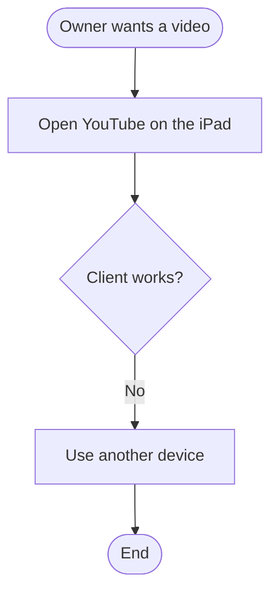
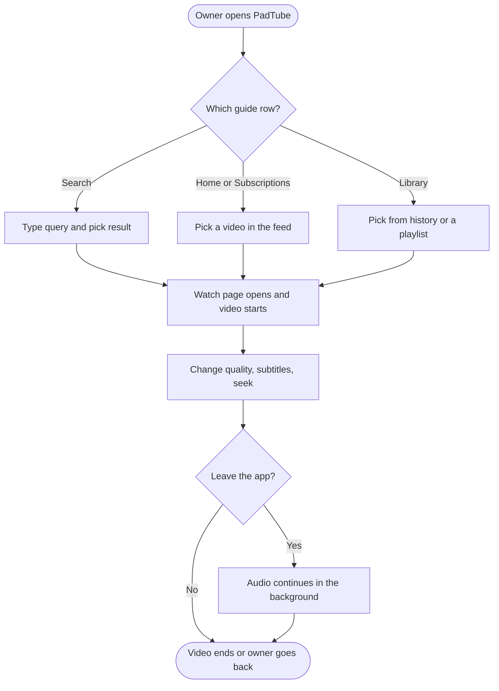
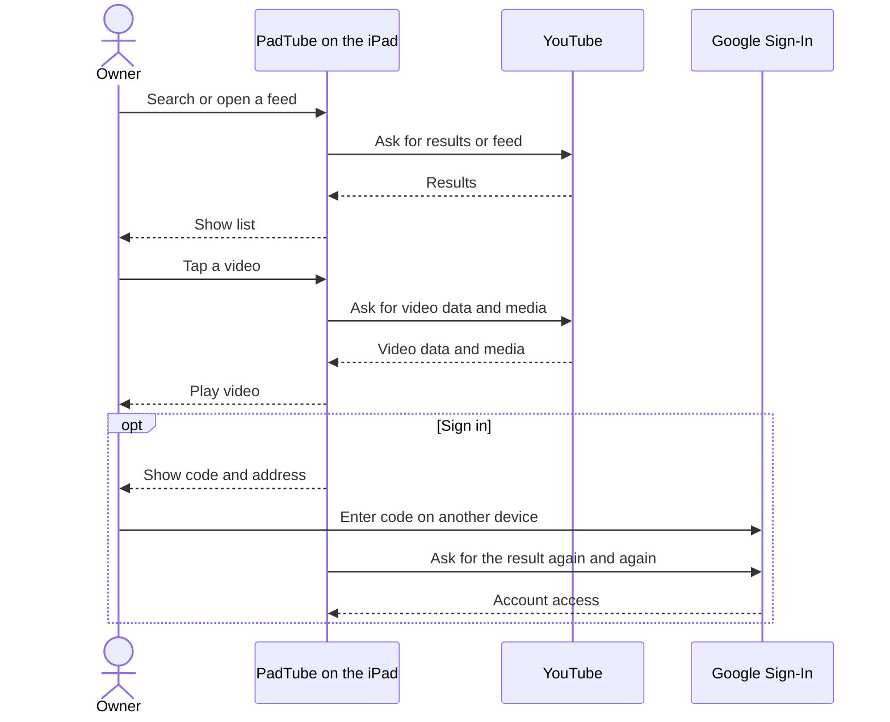
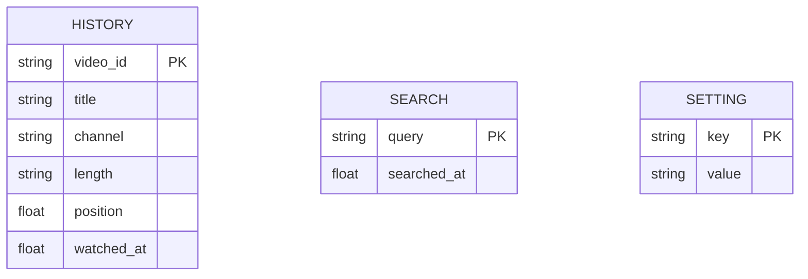

# Business Requirement: PadTube

**Document ID:** BREQ-PADTUBE
**Date:** 2026-11-11
**Author:** Claude (developer agent), for the owner
**Status:** Approved (owner approved all Phase 1 documents on 2026-11-11, see [local/BRIEF.md](../../../local/BRIEF.md))

---

## Executive Summary

PadTube is a native YouTube app for one device: the owner's jailbroken iPad mini 1 (iPad2,5, A5 2x Cortex-A9 1 GHz, armv7, 512 MB RAM, 1024x768, iOS 6.1.3). The owner is the only user. The app is for personal use. It is never published.

The official YouTube app and the YouTube web site do not work on iOS 6. PadTube gives back the core YouTube functions on this iPad. All work occurs on the iPad. There is no helper server.

The first owner rule controls all decisions: **smooth like a normal YouTube app is more important than the number of features.** Each feature has a gate that we measure on the real iPad. A feature that fails its gate is cut or limited. We do not ship it.

---

## 1. Business Context

### 1.1 Current State

| Item | Current state |
| :--- | :--- |
| Official YouTube app | Does not install or run on iOS 6.1.3 |
| YouTube in Safari 6 | Not usable (modern web player, no fMP4 HLS on iOS 6) |
| iPad hardware | Works. A5 decodes H.264 up to 1080p30 and AAC-LC ([research-features §2 F12](../../research/research-features.md#2-facts-for-2026-that-set-the-design)) |
| PadTube code | Phase 0 spike code exists and is the base: C core in `core/`, Objective-C layer in `ios/src/` ([decisions D4](../../decisions.md)) |

### 1.2 Business Objectives

- **O1:** The owner can find and watch any normal YouTube video on the iPad at a start time of 2.5 s or less at 360p.
- **O2:** The owner can use the account functions (home, subscriptions, history, Watch Later, playlists, like, subscribe) after one sign-in with a code.
- **O3:** The app feels smooth: list scroll at 55 fps or more, and no main-thread stall longer than 50 ms.
- **O4:** The app stays inside the RAM budget (120 MB steady, 180 MB peak), well below the iPad mini 1 crash point of about 275–297 MB ([research-efficiency §3](../../research/research-efficiency.md#3-quickjs-quickjs-ng-and-duktape-for-the-ejs-solver)).

### 1.3 Stakeholders

| Stakeholder | Role | Interest / impact |
| :---------- | :--- | :-------------- |
| Owner | Only user, approver | Wants a smooth YouTube app on the iPad mini 1. Does the device-code sign-in step himself. Checks the result by finger. |
| Developer agent (Claude) | Builds, tests, measures | Builds each phase, measures each gate on the iPad, records results in `docs/STATUS.md` and decisions in `docs/decisions.md`. |
| YouTube / Google | External service | Supplies InnerTube, media and OAuth endpoints. Can change them at any time without notice. |
| PadTerm session | Other user of the same iPad | Shares the iPad. Every command that touches the iPad uses `ipad-lock`. PadTube must not touch the PadTerm app. |

---

## 2. Problem Statement

The owner has a working iPad mini 1 but no way to use YouTube on it. Old clients for iOS 6 stopped working when YouTube changed its APIs. A new client must use the 2026 YouTube interfaces and must stay inside the limits of a 2012 CPU with 512 MB RAM.

### 2.1 Pain Points

- **P1:** No YouTube client works on iOS 6.1.3 in 2026.
- **P2:** Most 2026 playback paths need JavaScript challenge solving or PO tokens. One solve needs 1.66 s and 211 MB on a Mac ([research-efficiency §3.2](../../research/research-efficiency.md#32-measurements-measured-m-series-mac-quickjs-ng-0180-ejs-080-player-a5c2aafe)). The iPad cannot do this at play time.
- **P3:** iOS 6 plays only MPEG-TS HLS from `http://127.0.0.1`, not fMP4 ([research-features §2 F11](../../research/research-features.md#2-facts-for-2026-that-set-the-design)). YouTube serves fMP4 (DASH).
- **P4:** Unmasked list answers are large (MWEB search 160,049 B) and slow to parse on the A5 ([research-efficiency §1.2](../../research/research-efficiency.md#12-field-masks-gzip-and-protobuf-measured-host-youtubeigoogleapiscom-mweb-search)).
- **P5:** The A5 drops frames when the UI uses offscreen render effects (shadows, masks, corner radii) ([research-efficiency §5](../../research/research-efficiency.md#5-ui-smoothness-on-ios-6--a5)).

### 2.2 Business Impact

The iPad is not useful for its main purpose (video) without a client. A client that lags is not acceptable to the owner, even with many features (owner rule 1).

---

## 3. Proposed Solution

### 3.1 Solution Overview

A native app with a C core and a thin Objective-C UIKit layer, in the stock iOS 6 look (light and dark). The C core does network, InnerTube calls, JSON parse, fMP4-to-MPEG-TS remux, a local HLS server on 127.0.0.1, captions, and a SQLite store. Details: [padtube-core domain doc](../../architecture/domains/padtube-core.md) and [PLAN §1](../../../local/PLAN.md).

### 3.2 Key Features / Capabilities

- Search with suggestions and recent searches
- Watch a video: quality choice, seek, background audio, subtitles (manual and auto-generated)
- Sign in with a device code (TV client)
- Home, subscriptions, history, Watch Later, playlists, like, subscribe
- Tier 2: channels, chapters, comments (read), live, speed

### 3.3 Expected Benefits

- The owner can use YouTube on the iPad again.
- Video starts at 360p in 2.5 s or less on Wi-Fi at 130 KB/s or more (target).
- No JavaScript at play time, so no 211 MB solver peak during playback.

---

## 4. Requirements

### 4.1 Functional Requirements

Tier = owner tier ([BRIEF](../../../local/BRIEF.md) rule 2). MoSCoW: Tier 1 = Must Have, Tier 2 = Should Have, Tier 3 = Could Have, cuts = Won't Have.

| ID | Tier | Priority | Requirement | Acceptance criteria (use case) |
| :- | :--- | :------- | :---------- | :------------------ |
| FR-01 | 1 | Must Have | Search YouTube by text. Show results with paging. | AC-SEARCH-1 ([DUC-SEARCH-SEARCH](../../use_cases/domain/search/search.md)) |
| FR-02 | 1 | Must Have | Show search suggestions while the owner types. Keep recent searches. | AC-SEARCH-2, AC-SEARCH-3 ([DUC-SEARCH-SEARCH](../../use_cases/domain/search/search.md)) |
| FR-03 | 1 | Must Have | Play a video. Start at 360p in Auto. Let the owner choose a fixed quality up to 720p. | AC-WATCH-1, BR-PLAY-FORMAT, BR-PLAY-START ([DUC-PLAY-START](../../use_cases/domain/playback/start.md)) |
| FR-04 | 1 | Must Have | Seek to any time in the video. | AC-WATCH-4 ([BUC-WATCH-A-VIDEO](../../use_cases/business/watch-a-video.md)) |
| FR-05 | 1 | Must Have | Keep audio on when the app goes to the background or the screen locks. Show lock-screen controls. | AC-WATCH-3 ([BUC-WATCH-A-VIDEO](../../use_cases/business/watch-a-video.md)) |
| FR-06 | 1 | Must Have | Show subtitles: manual tracks and auto-generated tracks. | AC-CAPTIONS-1 ([DUC-CAP-SHOW](../../use_cases/domain/captions/show.md)) |
| FR-07 | 1 | Must Have | Sign in with an OAuth device code (TV client). Keep the sign-in after a restart. | AC-LOGIN-1, AC-LOGIN-2 ([DUC-ACCT-SIGN-IN](../../use_cases/domain/account/sign-in.md)), [BUC-SIGN-IN-WITH-CODE](../../use_cases/business/sign-in-with-code.md) |
| FR-08 | 1 | Must Have | Home: account feed when signed in; videos related to the last video watched when signed out ([D13](../../decisions.md)). | AC-LIB-1 ([DUC-LIB-BROWSE](../../use_cases/domain/library/browse.md)) |
| FR-09 | 1 | Must Have | Subscriptions feed (signed in). | AC-LIB-1 ([DUC-LIB-BROWSE](../../use_cases/domain/library/browse.md)) |
| FR-10 | 1 | Must Have | History: local history with resume position on the iPad; account history (read and write) when signed in. | AC-HISTORY-1, BR-HISTORY-RESUME ([DUC-HIST-RECORD](../../use_cases/domain/history/record.md)) |
| FR-11 | 1 | Must Have | Watch Later, Liked videos and own playlists: show, add to Watch Later, remove. Any public playlist: show. | AC-PLAYLIST-1, AC-LIB-1 ([DUC-LIB-BROWSE](../../use_cases/domain/library/browse.md)) |
| FR-12 | 1 | Must Have | Like and subscribe from the watch page (signed in). | AC-VPAGE-3 ([DUC-VPAGE-LOAD](../../use_cases/domain/video-page/load.md)) |
| FR-13 | 1 | Must Have | Watch page: title, channel, views, date, likes, description, related videos. | AC-WATCH-2 ([DUC-VPAGE-LOAD](../../use_cases/domain/video-page/load.md)) |
| FR-14 | 2 | Should Have | Channel pages with paging. | AC-CHANNEL-1 ([DUC-LIB-BROWSE](../../use_cases/domain/library/browse.md)) |
| FR-15 | 2 | Should Have | Chapters: list and jump. | AC-CHAPTERS-1 ([DUC-VPAGE-LOAD](../../use_cases/domain/video-page/load.md)) |
| FR-16 | 2 | Should Have | Comments, read only, on their own screen. | AC-COMMENTS-1 ([DUC-VPAGE-LOAD](../../use_cases/domain/video-page/load.md)) |
| FR-17 | 2 | Should Have | Live streams, limited: only when an HLS manifest exists ([research-efficiency §9](../../research/research-efficiency.md#9-features-to-cut-or-limit-for-smoothness)). | EF-PLAY-4 ([DUC-PLAY-START](../../use_cases/domain/playback/start.md)). Built: the iOS player reads `hls_url` directly; gate on the iPad in docs/STATUS.md. |
| FR-18 | 2 | Should Have | Playback speed. Cut ([D42](../../decisions.md)): iOS 6 ignores the rate for the local stream. | AC-WATCH-5 ([BUC-WATCH-A-VIDEO](../../use_cases/business/watch-a-video.md)) |
| FR-19 | 3 | Could Have | Dubbed audio tracks. | Not specified yet |
| FR-20 | 3 | Could Have | Light and dark theme in the stock iOS 6 look. | Owner check by finger (Phase 5) |
| FR-21 | 1 | Won't Have (now) | Auto-translated subtitles. YouTube gives HTTP 429 in 2026 ([research-features §4.3](../../research/research-features.md#43-captions-manual-auto-generated-auto-translate)). Try again only if an on-device PO token works. | — |

### 4.2 Non-Functional Requirements

The owner gates (G1–G6) are hard. We measure them on the real iPad on Wi-Fi at 130 KB/s or more ([research-efficiency §10.2](../../research/research-efficiency.md#102-per-feature-gates)). Measured values: measured on the iPad, see `docs/STATUS.md`.

| ID | Category | Requirement | Acceptance criteria |
| :- | :------- | :---------- | :------------------ |
| NFR-01 (G1) | Performance | List scroll | **≥ 55 fps** sustained; no frame > 33 ms (Instruments Core Animation) |
| NFR-02 (G2) | Performance | Search result on screen | **≤ 1.2 s** from tap to first results drawn |
| NFR-03 (G3) | Performance | Video start at the default quality (720p, owner decision D16) for any video length | **≤ 2.5 s** from tap to first frame on the owner's Wi-Fi; the real 720p number is in docs/STATUS.md |
| NFR-04 (G4) | Memory | RAM, steady state (480p video, list in the stack) | **≤ 120 MB** resident |
| NFR-05 (G5) | Memory | RAM, peak, any feature | **≤ 180 MB** |
| NFR-06 (G6) | Responsiveness | Main thread | **No stall > 50 ms** during scroll or playback |
| NFR-07 | Stability | Soak | 1 h of playback and use, no crash (PLAN §6 Phase 2 gate) |
| NFR-08 | Performance | Secondary targets from research-efficiency §10.2 | Seek restart ≤ 4 s; remux CPU ≤ 0.10 CPU-s per s at 480p; search payload ≤ 5 KB gzip; image RAM cache ≤ 12 MB; segment cache ≤ 4 segments; battery ≤ 12 % per hour at 480p |
| NFR-09 | Security / privacy | OAuth tokens stay in the local store on the iPad. No token in the repo, in a commit or in `docs/`. | Grep of the repo shows no token |
| NFR-10 | Platform | armv7, iOS 6.0 deployment target, `-mno-thumb` for all code, SQLite 3.7.13 SQL only | Build on the PadTerm toolchain; host test of the store SQL ([D11](../../decisions.md)) |

### 4.3 Business Rules

| ID | Rule |
| :- | :--- |
| BR-GATE | A feature that fails its gate is cut or limited, not shipped. |
| BR-NO-SERVER | No helper server. All work runs on the iPad. |
| BR-NO-JS-PLAY | No JavaScript at play time. A JS solver (QuickJS-NG + ejs) is a cached fallback in its own process only ([PLAN §2](../../../local/PLAN.md)). |
| BR-TV-TOKEN | Every signed-in call uses the TVHTML5 client. The device-code token does not work with other clients ([research-features §2 F6](../../research/research-features.md#2-facts-for-2026-that-set-the-design)). |
| BR-ONE-PLAYER | One player and one local stream at a time. |
| BR-NET-MASK | Search, player and watch-page requests use a field mask, with a no-mask fallback ([DUC-SEARCH-SEARCH](../../use_cases/domain/search/search.md), [D10, D15](../../decisions.md)). |

### 4.4 Cut or Limited (Won't Have)

From [PLAN §4](../../../local/PLAN.md) and [research-efficiency §9](../../research/research-efficiency.md#9-features-to-cut-or-limit-for-smoothness).

| Feature | Decision | Reason |
| :--- | :--- | :--- |
| 1080p | Cut | Panel is 1024x768. 3.1x the remux bytes of 720p. |
| VP9, AV1, Opus | Cut | No hardware decode on the A5. |
| JS solve at play time | Cut | 211 MB peak on a Mac; crash point 275–297 MB. |
| Shorts swipe feed | Built (owner request 2026-11-13, D53-D60) | Shorts tab: vertical swipe feed, two AVPlayers, reload button; `docs/design/shorts.md` |
| Animated previews | Cut | WebP or video; no WebP on iOS 6. |
| Inline autoplay in lists | Cut | One player only; remux would run during scroll. |
| Live chat | Cut | Constant poll keeps the radio on. |
| Blur, shadow, mask effects | Cut | Offscreen render on the A5. |
| Picture in picture | Cut | Not possible on iOS 6. |
| 720p | Limited | Manual choice only. Start 5.9–6.5 s at 130 KB/s. |
| Live | Limited | Only when an HLS manifest exists. |
| Comments | Limited | Own screen, load on tap. |

---

## 5. Process Flow

### 5.1 Current Process (As-Is)

### 5.2 Proposed Process (To-Be)

---

## 6. System Interactions

---

## 7. Data Requirements

### 7.1 Data Entities (local store on the iPad)

Settings hold the OAuth refresh token, token expiry, device ID, TV client ID and theme. Remote data (lists, video data) is not stored, except the thumbnail disk cache.

### 7.2 Data Quality Requirements

- One history row per video. A new open moves the row to the top and keeps the old position ([AC-HISTORY-1](../../use_cases/domain/history/record.md)).
- One row per recent search. A repeat moves it to the top ([AC-SEARCH-3](../../use_cases/domain/search/search.md)).
- One transaction per owner action ([research-efficiency §7](../../research/research-efficiency.md#7-storage)).

---

## 8. Analysis

### 8.1 Gap Analysis

| Current state | Desired state | Gap | Solution |
| :------------ | :------------ | :-- | :------- |
| No client | Native client | Whole app | C core + thin UIKit layer |
| YouTube serves fMP4 | iOS 6 plays TS HLS | Container | Remux 1 fragment = 1 TS segment, local HLS server ([D5](../../decisions.md)) |
| Most clients need JS / PO token | Play with no JS | Playback client | VISIONOS client with plain URLs ([research-features §2 F1](../../research/research-features.md#2-facts-for-2026-that-set-the-design)) |
| Large JSON | Small JSON | Payload | Field masks + gzip ([D10](../../decisions.md)) |
| No account on iOS 6 | Account functions | Sign-in | OAuth device code, TV client |

### 8.2 Impact Assessment

| Stakeholder / area | Impact level | Description | Mitigation |
| :--------------- | :----------- | :---------- | :--------- |
| Owner | High | Gets YouTube on the iPad | Gates protect smoothness |
| PadTerm session | Low | Shares the iPad | `ipad-lock` for every iPad command; no reboot; no uninstall loop |
| Google account | Medium | A TV device sign-in appears on the account | Owner does the code step himself |

---

## 9. Success Criteria

| Metric | Current value | Target value | Measurement method |
| :----- | :------------ | :----------- | :----------------- |
| Tier 1 features shipped | 0 | All, each with its gate passed | `docs/STATUS.md` feature table |
| Scroll fps | Measured on the iPad, see `docs/STATUS.md` | ≥ 55 | Instruments Core Animation |
| Search on screen | Measured on the iPad, see `docs/STATUS.md` | ≤ 1.2 s | App log wall clock (`lastLoadMs`) |
| 360p start | Measured on the iPad, see `docs/STATUS.md` | ≤ 2.5 s | App log "first frame" (`startMs`) |
| RAM steady / peak | Measured on the iPad, see `docs/STATUS.md` | ≤ 120 / ≤ 180 MB | Allocations / VM Tracker |
| Crashes in 1 h soak | Measured on the iPad, see `docs/STATUS.md` | 0 | Soak run |

---

## 10. Constraints & Assumptions

### 10.1 Constraints

- Target and test device: iPad2,5, iOS 6.1.3, A5, 512 MB. Other iPads and iOS versions get a build but no test run (D48).
- Toolchain = PadTerm: theos, iPhoneOS9.3-armv7.sdk, deployment 6.0, `-mno-thumb`, ldid, ideviceinstaller.
- No sudo on the Mac. No reboot of the iPad. No uninstall-and-install loop.
- Public since 2026-11-12 (D44): MIT, on GitHub. Not affiliated with Google or YouTube; no YouTube logo (D47).

### 10.2 Assumptions

- VISIONOS keeps plain media URLs with no JS ([research-features §2 F1](../../research/research-features.md#2-facts-for-2026-that-set-the-design)).
- The TV device-code flow still works for a real account in 2026 (works for Opaline and SmartTube; not yet tested by us).
- The owner's Wi-Fi gives 130 KB/s or more.

---

## 11. Risks

| Risk | Probability | Impact | Mitigation strategy |
| :--- | :---------- | :----- | :------------------ |
| YouTube removes VISIONOS plain URLs | Medium | High | Keep client version in one place; JS solver fallback in own process; SABR as last option |
| "Sign in to confirm you're not a bot" | Medium | Medium | New visitor ID and one retry ([EF-PLAY-1](../../use_cases/domain/playback/start.md)) |
| Device-code login fails for a real account | Low | High | Cookie sign-in in a UIWebView (research-features §4.4 option B) |
| Background audio stops on iOS 6 | Medium | Medium | Audio-only playlist from itag 140 in the background ([research-features §4.2](../../research/research-features.md#42-background-audio)) |
| A5 cannot hold 55 fps in lists | Low | High | Opaque cells, no offscreen effects, decode off the main thread |
| "Made for kids" videos do not play on VISIONOS | High | Low | Show the reason; no JS-free fallback ([research-features §2 F4](../../research/research-features.md#2-facts-for-2026-that-set-the-design)) |

---

## 12. Implementation Approach

### 12.1 Recommended Phases

From [PLAN §6](../../../local/PLAN.md).

1. **Phase 0 Spike:** measure A5 facts. Code becomes the base ([D4](../../decisions.md)).
2. **Phase 1 Docs:** this BREQ, use cases, domain doc.
3. **Phase 2 Watch core:** search, results, video page, player, quality, seek, captions, background audio, local history. Gate: all G1–G6 on the iPad, 1 h soak.
4. **Phase 3 Login:** device code; home, subscriptions, Watch Later, playlists, like, subscribe, account history. Gate: real account test.
5. **Phase 4 Tier 2:** channels, chapters, comments, live, speed. Gate: G1–G6.
6. **Phase 5 Polish:** light and dark look, `.deb`. Gate: owner check by finger.

### 12.2 Dependencies

- Phase 3 needs the owner to do the device-code step (code shown on the iPad and in `docs/STATUS.md` under "OWNER ACTION").
- All gates need the iPad, under `ipad-lock`.

---

## 13. Appendices

### 13.1 Glossary

- **InnerTube:** the private YouTube API (`/youtubei/v1/...`).
- **MWEB, VISIONOS, TVHTML5:** InnerTube client names. MWEB for lists, VISIONOS for playback, TVHTML5 for signed-in calls.
- **Field mask:** `&fields=` URL parameter; the server returns only the named fields.
- **DASH fragment:** one `moof` + `mdat` part of an fMP4 file, listed in the `sidx` box.
- **HLS:** HTTP Live Streaming; playlists (`.m3u8`) and MPEG-TS segments.
- **Gate:** a measured limit a feature must meet on the iPad before it ships.
- **Device code:** OAuth 2.0 device flow; a short code the owner types on another device.

### 13.2 References

- [local/BRIEF.md](../../../local/BRIEF.md), [local/PLAN.md](../../../local/PLAN.md)
- [research-features.md](../../research/research-features.md), [research-efficiency.md](../../research/research-efficiency.md)
- [decisions.md](../../decisions.md)
- Use cases: [watch-a-video](../../use_cases/business/watch-a-video.md), [sign-in-with-code](../../use_cases/business/sign-in-with-code.md)
- Domain: [padtube-core](../../architecture/domains/padtube-core.md)
