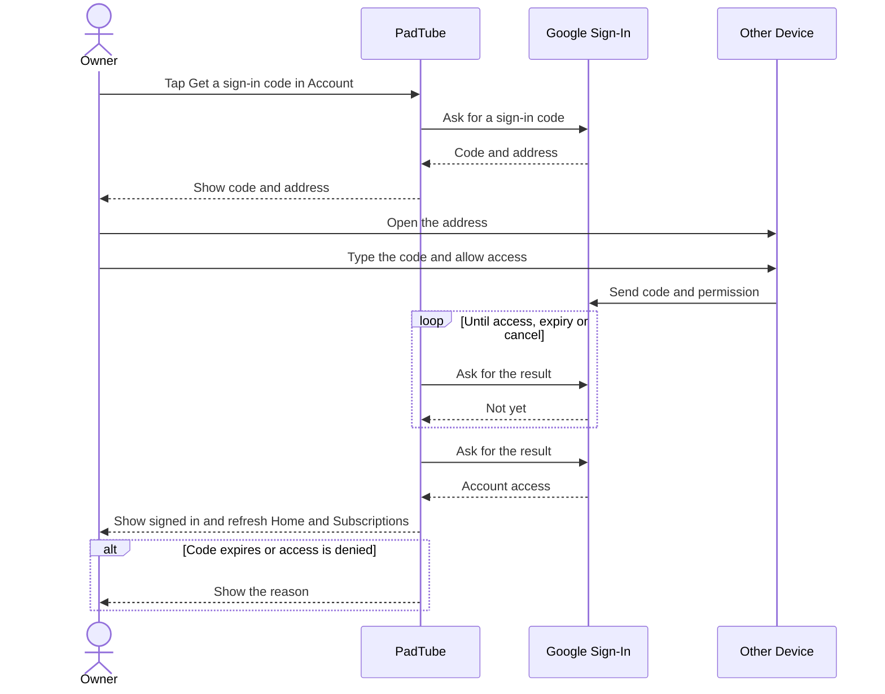

# BUC-SIGN-IN-WITH-CODE: Sign In with a Code

---

## Brief Description

The owner signs in to his YouTube account without a keyboard login on the iPad. PadTube shows a short code and an address. The owner opens the address on another device (phone or computer), types the code and allows access. PadTube asks Google again and again until the access arrives. After that, the account functions work: Home, Subscriptions, history, Watch Later, playlists, like and subscribe.

This journey uses the same method as a YouTube TV app ([research-features §4.4](../../research/research-features.md#44-login) option A). It implements [BREQ-PADTUBE](../../business/requirements/padtube.md) FR-07.

---

## Actors

| Actor | Type | Description |
|-------|------|-------------|
| **Owner** | Primary | Starts the sign-in on the iPad and enters the code on another device. |
| **PadTube** | System | Gets the code, shows it, and waits for the result. |
| **Google Sign-In** | Supporting | External service. Gives the code, checks it, and gives account access. |
| **Other Device** | Supporting | The owner's phone or computer with a web browser. |

---

## Preconditions

1. The owner is signed out in PadTube.
2. The iPad has network access.
3. The owner has a Google account and another device with a web browser.

---

## Postconditions

### Success Postconditions
1. PadTube shows the account as signed in.
2. Home shows the account feed. Subscriptions shows the subscription feed.
3. Library shows YouTube history, Watch Later, Liked videos and Playlists.
4. The sign-in stays after the app restarts.

### Failure Postconditions
1. PadTube stays signed out.
2. PadTube shows why (code expired, access denied, cancelled, no code).
3. The owner can start again.

---

## Main Success Scenario

### Sequence Diagram

### Step-by-Step Flow

| Step | Actor | Action | Details |
|------|-------|--------|---------|
| **1** | **Owner** | Start sign-in | • Opens Account (Sign In) in the guide • Taps "Get a sign-in code" |
| **2** | **PadTube** | Get a code | • Gets the TV app identity once and keeps it • Uses one fixed device identity for this iPad • Asks Google for a code (AC-LOGIN-1) |
| **3** | **PadTube** | Show the code | • Shows the code in 56 pt red, the short address `google.com/device` and a QR code of the address • Says: use your phone or computer; no password is typed on the iPad (BR-LOGIN-NOWEB) • **No web page opens on the iPad: the app has no web view** (owner rule 2026-11-11, [D28](../../decisions.md)) • During the build phases, the developer agent also writes the code to `docs/STATUS.md` under "OWNER ACTION" |
| **4** | **Owner** | Enter the code | • Opens the address on another device • Types the code • Picks the account and allows access |
| **5** | **PadTube** | Wait for the result | • Asks Google again at the interval Google gives (default 5 s) • "Not yet" means: continue to wait (AC-LOGIN-2) • A network error means: continue to wait • **Code expired:** PadTube asks for a new code and shows it by itself, up to 12 times (about 6 hours); no step for the owner (BR-LOGIN-RENEW) • Another app in front: the wait continues for about 10 minutes (iOS 6 background task), then when PadTube is in front again |
| **6** | **PadTube** | Keep the access | • Stores the access in the local store on the iPad only • Shows the account as signed in |
| **7** | **PadTube** | Refresh the account screens | • Home shows the account feed • Subscriptions shows the subscription feed |

---

## Alternative Flows

### Alternative Flow 1: Cancel
**Trigger:** Step 5 – the owner taps Cancel.

**Flow:**
- 5a. PadTube stops the wait.
- 5b. PadTube shows "Cancelled." and stays signed out.

### Alternative Flow 2: App restart
**Trigger:** Any time after Step 6 – the app starts again.

**Flow:**
- PadTube loads the stored access at launch.
- PadTube renews the access 5 minutes before it expires, and once more when YouTube says it expired early.
- The owner stays signed in.

### Alternative Flow 3: Sign out
**Trigger:** Any time after Step 6 – the owner taps Sign out.

**Flow:**
- PadTube deletes the stored access.
- Home goes back to the signed-out feed. Subscriptions shows "Sign in (Account in the guide) to see your subscriptions."

---

## Exception Flows

### Exception 1: No TV app identity
**Trigger:** Step 2 – PadTube cannot read the TV app identity from YouTube.

**Flow:**
- PadTube shows "Could not read the TV sign-in client."
- The owner can try again later.

### Exception 2: No code
**Trigger:** Step 2 – Google gives no code (for example a rate limit).

**Flow:**
- PadTube shows "Google did not give a sign-in code."
- The owner can try again later.

### Exception 3: Code expires
**Trigger:** Step 5 – the time limit from Google passes (default 30 minutes).

**Flow:**
- PadTube shows "The code expired."
- The owner starts again at Step 1.

### Exception 4: Access denied
**Trigger:** Step 4 – the owner refuses access on the other device.

**Flow:**
- PadTube shows the reason from Google.
- PadTube stays signed out.

---

## Business Rules

### BR-LOGIN-TV: TV identity only
- **Rule:** The account access works only for TV-type requests. PadTube uses the TV request type for every signed-in action. Video playback stays on the signed-out path.
- **Rationale:** Google accepts the device-code access only from the TV client ([research-features §2 F6](../../research/research-features.md#2-facts-for-2026-that-set-the-design)).
- **Enforcement:** [DUC-ACCT-SIGN-IN](../domain/account/sign-in.md), [DUC-LIB-BROWSE](../domain/library/browse.md).

### BR-LOGIN-PRIVATE: Access stays on the iPad
- **Rule:** The stored access stays in the local store on the iPad. It never goes into the repository, a commit, a document or a log.
- **Rationale:** Personal account; NFR-09.
- **Enforcement:** Step 6.

### BR-LOGIN-OWNER: Owner does the code step
- **Rule:** Only the owner enters the code. The developer agent never enters it.
- **Rationale:** Owner account ([local/BRIEF.md](../../../local/BRIEF.md) limits).
- **Enforcement:** Step 3 (code shown on the iPad and in `docs/STATUS.md`).

---

## Success Criteria

1. **Sign-in**
   - The owner signs in with one code, with no keyboard login on the iPad.
2. **Persistence**
   - The sign-in stays after an app restart and after the access expires (automatic renewal).
3. **Account functions**
   - Home and Subscriptions show account content right after sign-in.

---

## Acceptance Criteria

### Functional Acceptance Criteria

AC-LOGIN-1 and AC-LOGIN-2 are in [DUC-ACCT-SIGN-IN](../domain/account/sign-in.md). This BUC adds:

**AC-LOGIN-3: Real account**
- ✅ With a real account, the owner enters the code and PadTube shows signed in within one poll interval.
- ✅ Home then shows account items (FEwhat_to_watch).
- Status: open; needs the owner (OWNER ACTION in `docs/STATUS.md`).

**AC-LOGIN-4: Restart and renewal**
- ✅ After an app restart, PadTube is still signed in.
- ✅ After the access expires, the next account request succeeds (renewal).

**AC-LOGIN-5: Sign out**
- ✅ After Sign out, the stored access is gone and Subscriptions shows the sign-in message.

### Non-Functional Acceptance Criteria

**AC-LOGIN-6: No stall**
- ✅ The wait (Step 5) runs off the main thread: no main-thread stall > 50 ms (G6).

---

## Required Domain Operations

| Step | Domain UC | Aggregate | Link |
|------|-----------|-----------|------|
| 2–6 | Sign in | Account | [DUC-ACCT-SIGN-IN](../domain/account/sign-in.md) |
| 7 | Browse a list (TV) | Library | [DUC-LIB-BROWSE](../domain/library/browse.md) |

---

## Related Use Cases

- **BUC-WATCH-A-VIDEO: Watch a Video** – signed-in feeds lead into this journey; signed-in playback also writes the account history (link: [watch-a-video.md](./watch-a-video.md)).
- **DUC-HIST-RECORD: Record History** – account history write needs this sign-in (link: [record.md](../domain/history/record.md)).

---

## References

- **BREQ:** [padtube.md](../../business/requirements/padtube.md) – FR-07 to FR-12
- **Research:** [research-features.md](../../research/research-features.md) §4.4, §6.1

---

**Document Version:** 1.0
**Last Updated:** 2026-11-11
**Next Review:** Phase 3 (real account test)
