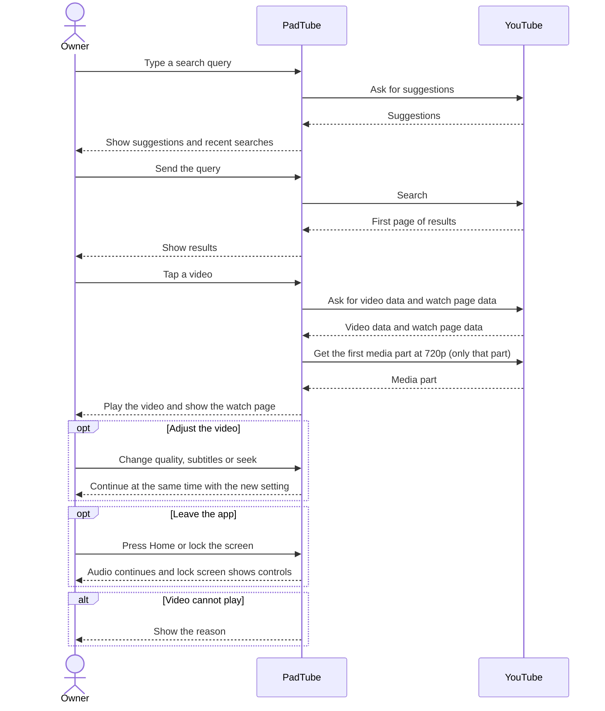

# BUC-WATCH-A-VIDEO: Watch a Video

---

## Brief Description

The owner finds a video by search, opens it, and watches it on the iPad mini 1. During the video the owner can change the quality, turn subtitles on or off, seek, and change the speed. When the owner leaves the app or locks the screen, the audio continues.

This is the main journey of PadTube ([BREQ-PADTUBE](../../business/requirements/padtube.md) FR-01 to FR-06, FR-13, FR-18). It must feel like a normal YouTube app: each step has a measured gate.

---

## Actors

| Actor | Type | Description |
|-------|------|-------------|
| **Owner** | Primary | The only user. Searches, picks, watches and adjusts the video. |
| **PadTube** | System | The app on the iPad. Finds videos, plays them, keeps history. |
| **YouTube** | Supporting | External service. Supplies results, video data, media and subtitles. |

---

## Preconditions

1. PadTube is installed and open on the iPad.
2. The iPad has Wi-Fi (target: 130 KB/s or more).
3. No sign-in is necessary for this journey.

---

## Postconditions

### Success Postconditions
1. The video plays to the end, or the owner stops it.
2. The video is at the top of the local history with its last position.
3. When signed in, the video is also in the account history.

### Failure Postconditions
1. PadTube shows a clear message (for example the reason from YouTube).
2. The local history is not changed when the video data does not arrive.
3. The app stays responsive. The owner can go back and pick another video.

---

## Main Success Scenario

### Sequence Diagram

### Step-by-Step Flow

| Step | Actor | Action | Details |
|------|-------|--------|---------|
| **1** | **Owner** | Type a query | • Taps the search field at the top right of the header • Types text |
| **2** | **PadTube** | Show suggestions | • Shows recent searches when the field is empty • Shows suggestions from YouTube while the owner types (AC-SEARCH-2, AC-SEARCH-3) |
| **3** | **Owner** | Send the query | • Taps Search or a suggestion |
| **4** | **PadTube** | Show results | • Keeps the query in recent searches • Shows the first page in 1.2 s or less (G2) • Gets the next page when the owner scrolls to the end (AC-SEARCH-1) |
| **5** | **Owner** | Tap a video | • Taps one row |
| **6** | **PadTube** | Open the watch page | • Asks for the video data at the tap, before the page shows • Shows title, channel, views, likes, description, related videos (AC-WATCH-2) |
| **7** | **PadTube** | Start the video | • Starts at the saved quality (default 720p); loads the video in parts, each part when the player asks for it • Starts from the saved position if the owner stopped in the middle before (BR-HISTORY-RESUME) • First frame in 2.5 s or less (G3) • Puts the video at the top of the history (AC-HISTORY-1) |
| **8** | **Owner** | Adjust (optional) | • Quality: Auto (720p first) \| 144p … 720p; the choice is kept for the next videos • Full screen: the screen turns to landscape; back to the old orientation after • Subtitles: Off \| a manual track \| an auto-generated track • Seek: drag the time bar or pick a chapter • Speed: cut ([D42](../../decisions.md)): iOS 6 ignores the rate for the local stream with both players |
| **9** | **PadTube** | Apply the change | • Continues at the same time with the new setting |
| **10** | **Owner** | Leave the app (optional) | • Presses Home or locks the screen |
| **11** | **PadTube** | Continue audio | • Audio continues • Lock screen shows title, channel and play / pause |
| **12** | **PadTube** | Keep the position | • Saves the position every 5 s and when the owner leaves the watch page |

---

## Alternative Flows

### Alternative Flow 1: Open from another list
**Trigger:** Step 1 – the owner starts from Home, Subscriptions, Library, a channel, a playlist or a related video.

**Flow:**
- 1a. The owner taps a video in that list.
- 1b. Continue at Step 6.

### Alternative Flow 2: Resume a video
**Trigger:** Step 7 – the history has a position for this video between 10 s from the start and 10 s from the end.

**Flow:**
- 7a. PadTube starts at the saved position.
- 7b. Continue at Step 8.

### Alternative Flow 3: Open a chapter
**Trigger:** Step 8 – the video has chapters.

**Flow:**
- 8a. The owner opens the chapter list and taps a chapter.
- 8b. PadTube seeks to the chapter start. Continue at Step 9.

### Alternative Flow 4: Open a related video
**Trigger:** Step 8 – the owner taps a related video.

**Flow:**
- 8a. PadTube stops the current video and saves its position.
- 8b. Continue at Step 6 with the new video.

---

## Exception Flows

### Exception 1: No results
**Trigger:** Step 4 – YouTube returns no item.

**Flow:**
- PadTube shows an empty list with a short message.
- The owner types another query. Use case resumes at Step 1.

### Exception 2: Video cannot play
**Trigger:** Step 7 – YouTube says the video is not playable (for example "Made for kids", members only, private, removed).

**Flow:**
- PadTube shows the reason text from YouTube.
- The owner goes back. Use case ends.

### Exception 3: Bot check
**Trigger:** Step 7 – YouTube asks to sign in to confirm the owner is not a bot.

**Flow:**
- PadTube tries once more with a new visitor identity (EF-PLAY-1).
- If YouTube asks again, PadTube shows the reason. Use case ends.

### Exception 4: Live stream
**Trigger:** Step 7 – the video is live.

**Flow:**
- PadTube gives the YouTube HLS manifest (`hls_url`) to the iOS player directly. Without a manifest, it shows "This live stream has no HLS manifest." (Tier 2; device result in docs/STATUS.md).
- Use case ends.

### Exception 5: Playback fails
**Trigger:** Step 7 or later – the player stops with an error.

**Flow:**
- PadTube shows "Playback failed." and the error text.
- The owner can go back and open the video again.

---

## Business Rules

### BR-WATCH-SMOOTH: Smooth first
- **Rule:** Every step meets its gate: search ≤ 1.2 s, start ≤ 2.5 s at the default 720p for any video length, scroll ≥ 55 fps, no main-thread stall > 50 ms, RAM ≤ 120 MB steady and ≤ 180 MB peak.
- **Rationale:** Owner rule 1.
- **Enforcement:** Measured on the iPad each phase; results in `docs/STATUS.md`.

### BR-WATCH-ONE: One video at a time
- **Rule:** Only one video plays at a time. A new watch page stops the one below it.
- **Rationale:** iOS 6 has one shared player. Two players cost RAM and CPU.
- **Enforcement:** Step 6 and Alternative Flow 4 (BR-PLAY-ONE in [DUC-PLAY-START](../domain/playback/start.md)).

### BR-WATCH-QUALITY: Start low
- **Rule:** Default 720p (owner decision D16). A picked quality is saved. Auto lists 720p first. No 1080p.
- **Rationale:** 360p start needs 242 KB, 720p needs 763–840 KB ([research-efficiency §4.5](../../research/research-efficiency.md#45-start-time-derived-from-42-startup-bytes--link-rate-one-video)).
- **Enforcement:** BR-PLAY-START, BR-PLAY-FORMAT.

### BR-HISTORY-RESUME: Resume in the middle only
- **Rule:** See [DUC-HIST-RECORD](../domain/history/record.md).

---

## Success Criteria

1. **Find**
   - The owner finds a video by search in 1.2 s or less per page.
2. **Watch**
   - The video starts at 360p in 2.5 s or less and plays to the end.
3. **Adjust**
   - Quality, subtitles and seek changes keep the current time.
4. **Background**
   - Audio continues with the screen locked.
5. **Memory**
   - The owner can stop and start the video later at the same position.

---

## Acceptance Criteria

### Functional Acceptance Criteria

The criteria of the operations are in the DUCs: AC-SEARCH-1, AC-SEARCH-2, AC-SEARCH-3, AC-WATCH-1, AC-WATCH-2, AC-CAPTIONS-1, AC-CHAPTERS-1, AC-HISTORY-1. This BUC adds the journey criteria below.

**AC-WATCH-3: Background audio**
- ✅ With a video in play, press Home: audio continues for 60 s or more.
- ✅ Lock the screen: audio continues; the lock screen shows title and channel.
- ✅ Lock-screen and headset play / pause buttons work.

**AC-WATCH-4: Seek**
- ✅ A seek to any time continues the video at that time (±1 segment).
- ✅ Seek restart ≤ 4 s on the iPad (research-efficiency §10.2 target).

**AC-WATCH-5: Quality changes**
- ✅ A quality change continues at the same time (±1 segment).
- ✅ The quality list shows Auto and each available height up to 720p.
- ❌ Speed: cut (D42). Measured on the iPad: rate 1.5 gave 6.01 s (MediaPlayer) and 6.02 s (AVPlayer) of video in 6 s (`tests/device/followups.py`).

### Non-Functional Acceptance Criteria

**AC-WATCH-6: Gates on the iPad**
- ✅ Search on screen ≤ 1.2 s (G2).
- ✅ 360p start ≤ 2.5 s (G3).
- ✅ Scroll ≥ 55 fps (G1); no main-thread stall > 50 ms (G6).
- ✅ RAM ≤ 120 MB steady, ≤ 180 MB peak (G4, G5).
- ✅ 1 h soak: no crash.

Measured values: measured on the iPad, see `docs/STATUS.md`.

---

## Required Domain Operations

| Step | Domain UC | Aggregate | Link |
|------|-----------|-----------|------|
| 2–4 | Search | Search | [DUC-SEARCH-SEARCH](../domain/search/search.md) |
| 6 | Load the watch page | Video page | [DUC-VPAGE-LOAD](../domain/video-page/load.md) |
| 7, 9 | Start playback | Playback | [DUC-PLAY-START](../domain/playback/start.md) |
| 8 | Show captions | Captions | [DUC-CAP-SHOW](../domain/captions/show.md) |
| 7, 12 | Record history | History | [DUC-HIST-RECORD](../domain/history/record.md) |
| 1a | Browse a list | Library | [DUC-LIB-BROWSE](../domain/library/browse.md) |

---

## Related Use Cases

- **BUC-SIGN-IN-WITH-CODE: Sign In with a Code** – after sign-in, Home and Subscriptions also lead into this journey (link: [sign-in-with-code.md](./sign-in-with-code.md)).

---

## References

- **BREQ:** [padtube.md](../../business/requirements/padtube.md) – FR-01 to FR-06, FR-13, FR-18, NFR-01 to NFR-07
- **Research:** [research-features.md](../../research/research-features.md) §4.1, §4.2, §4.3, §4.5; [research-efficiency.md](../../research/research-efficiency.md) §4.5, §5, §10.2
- **Decisions:** [decisions.md](../../decisions.md) D5–D10, D12, D13

---

**Document Version:** 1.0
**Last Updated:** 2026-11-11
**Next Review:** End of Phase 2 (watch core gates on the iPad)
