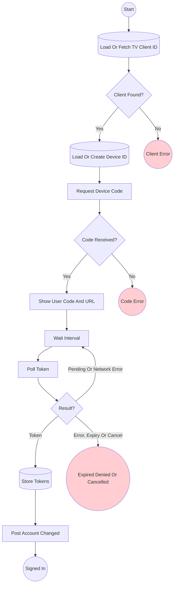

# DUC-ACCT-SIGN-IN: Sign In

---

## Brief Description

PadTube runs the Google OAuth 2.0 device flow with the YouTube TV client ID. It gets a device code, shows the user code, polls for the token, and keeps the refresh token in the local store. The token works only with the TVHTML5 InnerTube client.

---

## Entity Definition

See **[account (tb_oauth)](../../../architecture/domains/padtube-core.md#account-tb_oauth)** in the domain model.

**Key fields for this use case:**
- `tb_oauth_client`: `client_id`, `client_secret` (read from the TV `base.js`).
- `tb_device_code`: `user_code`, `verification_url`, `device_code`, `interval`, `expires_in`.
- `tb_token`: `access_token`, `refresh_token`, `expires_in`, `error`.

---

## Actors

| Actor | Type | Description |
|-------|------|-------------|
| **Owner** | Primary | Starts sign-in; enters the code on another device |
| **Account Service** | System | Device flow, token storage, refresh |
| **Google OAuth** | External | `youtube.com/o/oauth2/device/code` and `/o/oauth2/token` |

---

## Preconditions

1. The owner is signed out.
2. The local store is open.

---

## Postconditions

### Success

1. The local store holds `oauth.refresh` and `oauth.expires`.
2. The core uses the access token for TVHTML5 calls.
3. The app posts "account changed"; Home and Subscriptions reload.

### Failure

1. No token is stored. The account stays signed out.
2. The UI shows the error text.

---

## Flows

### Flow Diagram



### Main Success Flow

| Step | Component | Action | Details |
|------|-----------|--------|---------|
| **1** | **Account Service** | Get Client | • Cached ID and secret, else `GET https://www.youtube.com/tv` (Cobalt User-Agent, `Accept-Language: en-US`), find `base.js`, regex `clientId:"…",…:"<secret>"` |
| **2** | **Account Service** | Get Device ID | • One UUID per iPad, stored as `oauth.device_id` |
| **3** | **Account Service** | Request Code | • `POST /o/oauth2/device/code` with `client_id`, scope, `device_id`, `device_model` |
| **4** | **UI** | Show Code | • `user_code` and `verification_url` (`https://www.google.com/device`) |
| **5** | **Account Service** | Poll | • Every `interval` s (default 5) until `expires_in` (default 1800 s) or cancel<br>• `authorization_pending` / `slow_down` → wait<br>• Network error → wait<br>• The proxy can answer errors with HTTP 200: read the body |
| **6** | **Local Store** | Store Tokens | • `oauth.refresh`, `oauth.expires` (now + `expires_in`, default 3600 s) |
| **7** | **Account Service** | Announce | • Sets the token in the core; posts `TBAccountChanged` |

### Alternative Flows

#### AF1: Restore at launch
**Trigger:** App launch with a stored refresh token.
- The service loads the token and refreshes it when it expires within 5 minutes.

#### AF2: Refresh
**Trigger:** Before a signed-in call, the token expires within 5 minutes; or a call gets HTTP 401.
- `POST /o/oauth2/token` with `grant_type=refresh_token`. On 401 the call runs once more after the refresh.

#### AF3: Sign out
**Trigger:** The owner taps Sign out.
- The service clears the tokens in memory and deletes `oauth.refresh`; posts `TBAccountChanged`.

### Exception Flows

#### EF-LOGIN-1: No TV client

| Step | Component | Action | Details |
|------|-----------|--------|---------|
| **1a** | **UI** | Show error | • "Could not read the TV sign-in client." |

#### EF-LOGIN-2: No code

| Step | Component | Action | Details |
|------|-----------|--------|---------|
| **3a** | **UI** | Show error | • "Google did not give a sign-in code." (for example 403 `rate_limit_exceeded`) |

#### EF-LOGIN-3: Expired, denied or cancelled

| Step | Component | Action | Details |
|------|-----------|--------|---------|
| **5a** | **UI** | Show error | • Expiry: "The code expired."<br>• Google error (for example `access_denied`): the error text<br>• Cancel: "Cancelled." |

---

## Business Rules

### Field Rules

| Field | Rule | Description | Enforcement |
|-------|------|-------------|-------------|
| **client_id** | BR-LOGIN-CLIENT | Take the TV client ID and secret from the live TV `base.js`, not from a hard-coded value ([research-features §4.4](../../../research/research-features.md#44-login)). | Step 1 |
| **device_id** | BR-LOGIN-DEVICE | One stable device ID per iPad. | Step 2 |

### Entity Rules

| Rule | Description | Enforcement |
|------|-------------|-------------|
| **BR-LOGIN-TV** | Use the token only with the TVHTML5 client. Media playback stays on anonymous VISIONOS ([research-features §2 F6](../../../research/research-features.md#2-facts-for-2026-that-set-the-design)). | Step 7, all signed-in calls |
| **BR-LOGIN-PRIVATE** | Tokens live only in the local store on the iPad; never in the repo, `docs/` or logs. | Step 6 |
| **BR-LOGIN-POLL** | Pending is not an error: poll at `interval` until expiry. | Step 5 |
| **BR-LOGIN-RENEW** | When a code expires (`expired_token`), get a new code and show it without a step from the person; stop after 12 codes. Final answers such as `access_denied` stop the wait. | Step 5 |
| **BR-LOGIN-NOWEB** | No web page and no web view for sign-in, or anywhere in the app. The person enters the code on a phone or computer (owner rule 2026-11-11, [D28](../../../decisions.md)). | All steps |

---

## Data Requirements

### Input Data

| Field | Type | Required | Validation | Example |
|-------|------|----------|------------|---------|
| device_id | String | Yes | Stored UUID | "padtube-host-test-0000" |

### Output Data

**tb_device_code:**
```json
{"user_code": "ABC-DEF-GHI", "verification_url": "https://www.google.com/device", "interval": 5, "expires_in": 1800}
```

---

## Acceptance Criteria

### Functional

| AC | Description |
|----|-------------|
| **AC-LOGIN-1** | The parser finds `client_id` and `client_secret` in a 2026-shape `base.js` golden vector and fails on a text with no secret (`tests/host/test_oauth.c` `test_oauth_parse_client`). The live TV page gives a client ID that ends in `.apps.googleusercontent.com`; the device-code request gives a `user_code` of 6+ characters and a `verification_url` with `google.com/device` (`tests/e2e/test_youtube.c` `test_oauth_device_code_pending`). |
| **AC-LOGIN-2** | A poll before anyone enters the code returns 1 (pending), not a token and not an error (`test_oauth_device_code_pending`). |

### Non-Functional

| AC | Description |
|----|-------------|
| **AC-ACCT-3** | The poll loop runs on a background queue; no main-thread stall > 50 ms (G6). |
| **AC-LOGIN-7** | The Account screen shows the code (56 pt), `google.com/device` and a QR code that encodes the address (golden vector: `tests/host/test_qr.c`); screenshot on the iPad: `tests/artifacts/device/look_port_signin.png` (checked by eye). `tests/host/test_no_webview.c` fails if a web view enters the code. |

Real-account criteria (AC-LOGIN-3 to AC-LOGIN-5) are in [BUC-SIGN-IN-WITH-CODE](../../business/sign-in-with-code.md).

---

## Supports Business UCs

- [Sign In with a Code](../../business/sign-in-with-code.md) – Steps 2–6

---

## Related Domain UCs

- [DUC-LIB-BROWSE: Browse a List](../library/browse.md) – uses the token for TV browse
- [DUC-HIST-RECORD: Record History](../history/record.md) – uses the token for history pings

---

## References

- **Domain Model:** [padtube-core.md](../../../architecture/domains/padtube-core.md) – account (tb_oauth)
- **Code contract:** `core/tb_oauth.h`; `ios/src/TBAccount.h`
- **Research:** [research-features §4.4, §6.1](../../../research/research-features.md#44-login)
