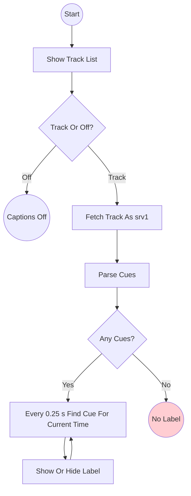

# DUC-CAP-SHOW: Show Captions

---

## Brief Description

The owner picks one caption track (manual or auto-generated) for the current video. PadTube gets the track in `srv1` format, parses it into cues, and draws the current cue in its own label over the video.

---

## Entity Definition

See **[tb_player](../../../architecture/domains/padtube-core.md#tb_player)** (`caps[]`, type `tb_ctrack`) and **[tb_captions](../../../architecture/domains/padtube-core.md#tb_captions)** in the domain model.

**Key fields for this use case:**
- `tb_ctrack.base_url`, `lang`, `name`, `asr` (1 = auto-generated).
- `tb_cue.start`, `dur`, `text`.

---

## Actors

| Actor | Type | Description |
|-------|------|-------------|
| **Owner** | Primary | Opens the CC menu and picks a track or Off |
| **Captions Service** | System | Fetches and parses the track; picks the current cue |
| **YouTube** | External | timedtext endpoint (no PO token for VISIONOS URLs) |

---

## Preconditions

1. The player answer of the current video has arrived ([DUC-PLAY-START](../playback/start.md)).
2. The answer lists one or more caption tracks.

---

## Postconditions

### Success

1. The current cue text shows over the bottom of the video, above the controls.
2. The label hides when no cue covers the current time.

### Failure

1. No label shows. The video continues.

---

## Flows

### Flow Diagram



### Main Success Flow

| Step | Component | Action | Details |
|------|-----------|--------|---------|
| **1** | **UI** | Show Track List | • One row per track; an auto-generated track shows "<name> (auto-generated)"<br>• One "Off" row |
| **2** | **Captions Service** | Fetch Track | • `GET <base_url>&fmt=srv1` off the main thread |
| **3** | **Captions Service** | Parse Cues | • `<text start dur>` elements → `tb_cue` (start, dur, text)<br>• Text is unescaped twice (srv1 escapes it twice) |
| **4** | **UI** | Find Current Cue | • Every 0.25 s (player tick): the cue with start ≤ time < start + dur |
| **5** | **UI** | Draw Label | • White bold 18 pt text on black at 60 % alpha, up to 3 lines<br>• Updates the label only when the text changes |

### Alternative Flows

#### AF1: Turn captions off
**Trigger:** The owner picks Off.
- The UI hides the label and drops the cues.

#### AF2: New video or quality change
**Trigger:** A new video starts.
- Captions start Off for the new video. A quality change keeps the cues (same video).

### Exception Flows

#### EF-CAP-1: No tracks

**Trigger:** The player answer lists no caption track.

| Step | Component | Action | Details |
|------|-----------|--------|---------|
| **1a** | **UI** | Show Off only | • The track list has only Off |

#### EF-CAP-2: Empty track

**Trigger:** The track gives zero cues (for example an empty body).

| Step | Component | Action | Details |
|------|-----------|--------|---------|
| **3a** | **UI** | No label | • The label stays hidden; the video continues |

---

## Business Rules

### Field Rules

| Field | Rule | Description | Enforcement |
|-------|------|-------------|-------------|
| **format** | BR-CAP-FORMAT | Use `fmt=srv1`: 3.6 KB vs 14.8 KB `vtt` for the same track ([research-features §4.3](../../../research/research-features.md#43-captions-manual-auto-generated-auto-translate), [D9](../../../decisions.md)). | Step 2 |
| **asr** | BR-CAP-ASR | Show both manual and auto-generated tracks. Mark auto-generated tracks in the list. | Step 1 |
| **lang** | BR-CAP-ORDER | List order: tracks in the device languages first (iPad language order), then English, then the rest by name; manual before auto-generated in one language (`tb_caps_sort`, [D41](../../../decisions.md)). YouTube's own order put Arabic first (owner report 2026-11-12). | Step 1 |

### Entity Rules

| Rule | Description | Enforcement |
|------|-------------|-------------|
| **BR-CAP-DRAW** | Draw captions in an own label over the video. Do not put subtitles into the HLS stream (iOS 6 support is UNVERIFIED). Own full screen keeps the label visible ([D8](../../../decisions.md)). | Step 5 |
| **BR-CAP-NO-TRANSLATE** | No auto-translated tracks (`tlang`): HTTP 429 in 2026 ([research-features §2 F9](../../../research/research-features.md#2-facts-for-2026-that-set-the-design)). | Step 1 |

---

## Data Requirements

### Input Data

| Field | Type | Required | Validation | Example |
|-------|------|----------|------------|---------|
| track index | Int | Yes | -1 (Off) or 0..ncaps-1 | 0 |

### Output Data

**tb_captions:**
```json
{"cues": [{"start": "seconds", "dur": "seconds", "text": "…"}], "n": "> 20 for dQw4w9WgXcQ"}
```

---

## Acceptance Criteria

### Functional

| AC | Description |
|----|-------------|
| **AC-CAPTIONS-1** | For `dQw4w9WgXcQ` the player answer has one manual and one auto-generated track; each fetch returns more than 20 cues; the first manual cue has text. Test: `tests/e2e/test_youtube.c` `test_captions_srv1`. |
| **AC-CAP-2** | On the iPad the label shows the cue within 0.25 s of its start and hides after its end; it stays visible in full screen. |

### Non-Functional

| AC | Description |
|----|-------------|
| **AC-CAP-ORDER** | Golden order: tracks ar, de, en (auto), en-GB, vi, zh-Hans with device languages vi-VN, en give vi, en-GB, en (auto), ar, zh-Hans, de (`tests/host/test_captions_order.c`). On the iPad (English) a video with 9 tracks lists en, en (auto), then Arabic, Italian, ... by name (`tests/device/caption_order.py`). |
| **AC-CAP-3** | Fetch and parse run off the main thread; no main-thread stall > 50 ms (G6). |

---

## Supports Business UCs

- [Watch a Video](../../business/watch-a-video.md) – Step 8 (subtitles)

---

## Related Domain UCs

- [DUC-PLAY-START: Start Playback](../playback/start.md) – gives the track list

---

## References

- **Domain Model:** [padtube-core.md](../../../architecture/domains/padtube-core.md) – tb_player, tb_captions
- **Code contract:** `core/tb_yt.h` `tb_yt_captions`, `tb_yt_parse_captions`; `ios/src/TBPlayerView.h` `selectCaptionIndex:`
- **Research:** [research-features §4.3, §6.3](../../../research/research-features.md#43-captions-manual-auto-generated-auto-translate)
