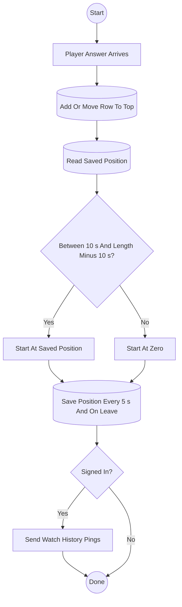

# DUC-HIST-RECORD: Record History

---

## Brief Description

When a video opens, PadTube puts it at the top of the local history on the iPad and keeps its play position. The next open of the same video starts from that position. When the owner is signed in, PadTube also writes the video to the account history with the YouTube watch-history pings.

---

## Entity Definition

See **[tb_hist](../../../architecture/domains/padtube-core.md#tb_hist)** in the domain model.

**Key fields for this use case:**
- `video_id` (required, key): 11-character video ID.
- `title`, `channel`, `length` (optional): a NULL value keeps the stored value.
- `position` (seconds), `watched_at` (unix seconds).

---

## Actors

| Actor | Type | Description |
|-------|------|-------------|
| **Owner** | Primary | Opens, watches and leaves videos; deletes history rows |
| **History Service** | System | Writes rows and positions in the local store |
| **Local Store** | System | SQLite 3.7.13 in WAL mode on the iPad |
| **YouTube** | External | TV player (playbackTracking) and videostats ping URLs (signed in only) |

---

## Preconditions

1. The local store is open (at app launch).
2. For the account part: the owner is signed in ([DUC-ACCT-SIGN-IN](../account/sign-in.md)).

---

## Postconditions

### Success

1. The video is the first row of the local history.
2. The stored position is the last saved play time.
3. Signed in: the video is in the account history (FEhistory).

### Failure

1. The local history does not change when the player answer does not arrive.

---

## Flows

### Flow Diagram



### Main Success Flow

| Step | Component | Action | Details |
|------|-----------|--------|---------|
| **1** | **History Service** | Add Row | • At the player answer: video ID, title, channel<br>• Existing row: moves to the top, keeps the old position and the fields given as NULL<br>• One transaction |
| **2** | **History Service** | Read Position | • 0 when the video is not in the history |
| **3** | **Playback** | Choose Start | • Resume only when 10 s ≤ position ≤ length − 10 s; else start at 0 |
| **4** | **History Service** | Save Position | • Every 5 s while the watch page is open, when another watch page covers it, and when the owner leaves it<br>• Only when the play time > 1 s |
| **5** | **Account** | Send Pings (signed in) | • TVHTML5 `player` call with the token; mask `playbackTracking(videostatsPlaybackUrl,videostatsWatchtimeUrl)`<br>• Ping the playback URL once with `ver=2`, a fresh 16-character `cpn`, `fmt=251&rtn=0&rt=0` |

### Alternative Flows

#### AF1: Delete a row
**Trigger:** The owner deletes a row in Library → History.
- The service deletes the row and its position (one transaction).

#### AF2: Watch-time pings
**Trigger:** Playback continues (signed in).
- The research shows watch-time pings with `st`, `et`, `cmt` and `final=1` on close ([research-features §4.8](../../../research/research-features.md#48-history)). Open: not built.

### Exception Flows

#### EF-HIST-1: Unknown video ID on delete

**Trigger:** The ID is not in the history.

| Step | Component | Action | Details |
|------|-----------|--------|---------|
| **AF1a** | **History Service** | No change | • Returns success; nothing changes |

---

## Business Rules

### Field Rules

| Field | Rule | Description | Enforcement |
|-------|------|-------------|-------------|
| **position** | BR-HISTORY-RESUME | Save the position as the owner watches. Resume only from the middle: not from the first 10 s and not from the last 10 s. A new open of a video keeps its position. | Steps 1, 3, 4 |
| **cpn** | BR-HIST-CPN | A fresh 16-character `cpn` per playback. A reused `cpn` drops later history entries (Opaline WatchtimeTracker). | Step 5 |

### Entity Rules

| Rule | Description | Enforcement |
|------|-------------|-------------|
| **BR-HIST-ONE** | One row per video. Newest first. | Step 1 |
| **BR-HIST-TX** | One transaction per owner action ([research-efficiency §7](../../../research/research-efficiency.md#7-storage)). | Steps 1, 4, AF1 |
| **BR-HIST-SQL** | SQL runs on SQLite 3.7.13: no UPSERT, no window functions ([D11](../../../decisions.md)). | All steps |

---

## Data Requirements

### Input Data

| Field | Type | Required | Validation | Example |
|-------|------|----------|------------|---------|
| video_id | String | Yes | 11 characters | "aaaaaaaaaaa" |
| title | String | No | NULL keeps the stored value | "First" |
| channel | String | No | NULL keeps the stored value | "Ch" |
| position | Double (s) | No | > 1 to save | 42.5 |

### Output Data

**tb_hist (list, newest first):**
```json
[{"video_id": "aaaaaaaaaaa", "title": "First", "channel": "Ch", "length": "1:00", "position": 42.5, "watched_at": 1762869600.0}]
```

---

## Acceptance Criteria

### Functional

| AC | Description |
|----|-------------|
| **AC-HISTORY-1** | Add A, add B, save position 42.5 for A, add A again with NULL channel: the list has 2 rows, A first, channel "Ch" kept, position 42.5 kept. Delete A: 1 row stays. Test: `tests/host/test_store.c` `test_store_history_and_position` (with BR-HISTORY-RESUME). |
| **AC-HIST-2** | Signed in: after a video plays, it is in the account history (FEhistory). Open: needs a real account and the ping call site (see Open items). |

### Non-Functional

| AC | Description |
|----|-------------|
| **AC-HIST-3** | Store writes do not stall the main thread > 50 ms (G6). |

---

## Open items

| Item | State |
|------|-------|
| Account history ping | `TBWatchController` calls `TBAccount reportWatch:` once per playback when the player answer is OK and the person is signed in. Watch-time pings are not built. |
| Watch-time pings | Not built (AF2). |

---

## Supports Business UCs

- [Watch a Video](../../business/watch-a-video.md) – Steps 7 and 12
- [Sign In with a Code](../../business/sign-in-with-code.md) – account history after sign-in

---

## Related Domain UCs

- [DUC-PLAY-START: Start Playback](../playback/start.md) – uses the resume position
- [DUC-LIB-BROWSE: Browse a List](../library/browse.md) – shows the account history (FEhistory)

---

## References

- **Domain Model:** [padtube-core.md](../../../architecture/domains/padtube-core.md) – tb_hist, store component
- **Code contract:** `core/tb_store.h`; `core/tb_yt.h` `tb_yt_tracking`, `tb_yt_ping`; `ios/src/TBAccount.h` `reportWatch:`
- **Research:** [research-features §4.8](../../../research/research-features.md#48-history)
