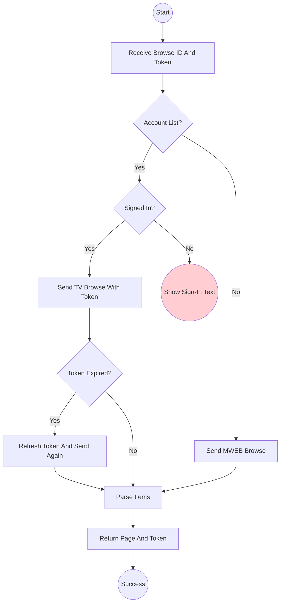

# DUC-LIB-BROWSE: Browse a List

---

## Brief Description

PadTube gets one page of a YouTube list by its browse ID and returns it as a `tb_list` with a continuation. Signed-in lists (Home, Subscriptions, history, Watch Later, Liked videos, playlists) use the TVHTML5 client with the OAuth token. Channel and playlist pages use the anonymous MWEB client.

---

## Entity Definition

See **[tb_list](../../../architecture/domains/padtube-core.md#tb_list)** and **[tb_item](../../../architecture/domains/padtube-core.md#tb_item)** in the domain model.

**Key fields for this use case:**
- `browse_id` (input), `continuation` (input / output).
- `items[]` with `set_video_id` for playlist items (needed to remove an item).
- `title`, `subtitle`, `subscribed` (channel pages).

### Browse IDs

| Screen | Browse ID | Client | Sign-in |
|--------|-----------|--------|---------|
| Home | `FEwhat_to_watch` | TVHTML5 + Bearer | Yes |
| Subscriptions | `FEsubscriptions` | TVHTML5 + Bearer | Yes |
| Library → YouTube history | `FEhistory` | TVHTML5 + Bearer | Yes |
| Library → Watch Later | `VLWL` | TVHTML5 + Bearer | Yes |
| Library → Liked videos | `VLLL` | TVHTML5 + Bearer | Yes |
| Library → Playlists | `FEplaylist_aggregation` | TVHTML5 + Bearer | Yes |
| Channel page | `UC…` + tab params (Videos `EgZ2aWRlb3PyBgQKAjoA`, Live `EgdzdHJlYW1z8gYECgJ6AA%3D%3D`, Playlists `EglwbGF5bGlzdHPyBgQKAkIA`); channel bar with avatar, name, subscribers, Subscribe (2012 look, §7.2) | MWEB | No (Subscribe: TV) |
| Playlist page | `VL<playlist id>` | MWEB | No |

---

## Actors

| Actor | Type | Description |
|-------|------|-------------|
| **Owner** | Primary | Opens a guide row (Home Feed, Subscriptions, Library rows), a channel or a playlist; scrolls to the end |
| **Library Service** | System | Builds the browse request and parses the answer |
| **YouTube** | External | InnerTube `browse` |

---

## Preconditions

1. For TVHTML5 browse IDs: the owner is signed in ([DUC-ACCT-SIGN-IN](../account/sign-in.md)).
2. For page 2+: the previous page gave a continuation.

---

## Postconditions

### Success

1. The list shows one more page of items.

### Failure

1. The list shows its empty text or the error text.

---

## Flows

### Flow Diagram



### Main Success Flow

| Step | Component | Action | Details |
|------|-----------|--------|---------|
| **1** | **Library Service** | Receive Request | • `browse_id`, optional `continuation`, optional channel tab params |
| **2** | **Library Service** | Pick Client | • TV browse IDs → TVHTML5 + `Authorization: Bearer`<br>• Channel / playlist → MWEB |
| **3** | **Library Service** | Send Browse | • `POST /youtubei/v1/browse`, `prettyPrint=false`, gzip, kept-alive connection |
| **4** | **Library Service** | Parse Items | • TV: tile renderers; MWEB: video, lockup and channel renderers<br>• Page title and subtitle for channels and playlists |
| **5** | **Library Service** | Return Page | • `tb_list` with `items`, `continuation`, `title` |

### Alternative Flows

#### AF1: Signed-out Home
**Trigger:** Home while signed out.
- Videos related to the last video in the local history; a starter search when the history is empty ([D13](../../../decisions.md)). The signed-out home feed is empty in 2026 ([research-features §2 F8](../../../research/research-features.md#2-facts-for-2026-that-set-the-design)).

#### AF2: Edit a playlist (signed in)
**Trigger:** The owner adds a video to Watch Later, or deletes a row in a VL list.
- Add: `browse/edit_playlist` `ACTION_ADD_VIDEO` with `playlistId=WL`.
- Remove: `ACTION_REMOVE_VIDEO` with the item `set_video_id`.

#### AF3: Signed-out Library
**Trigger:** Library while signed out.
- Library shows only the local history ([DUC-HIST-RECORD](../history/record.md)).

### Exception Flows

#### EF-LIB-1: Account list while signed out

| Step | Component | Action | Details |
|------|-----------|--------|---------|
| **2a** | **UI** | Show text | • Subscriptions: "Sign in (Account in the guide) to see your subscriptions." |

#### EF-LIB-2: Empty list

| Step | Component | Action | Details |
|------|-----------|--------|---------|
| **5a** | **UI** | Show empty text | • The list empty-text message |

---

## Business Rules

### Field Rules

| Field | Rule | Description | Enforcement |
|-------|------|-------------|-------------|
| **set_video_id** | BR-LIB-SETID | A playlist item keeps its `set_video_id`; remove uses it, not the video ID. | Step 4, AF2 |

### Entity Rules

| Rule | Description | Enforcement |
|------|-------------|-------------|
| **BR-LOGIN-TV** | Account lists use only TVHTML5 with the token (a WEB request with the token gives HTTP 400). | Step 2 |
| **BR-LIB-401** | HTTP 401 → refresh the token and send once more. | Step 3 |
| **BR-LIB-PLAYLIST-TV** | Signed in, a playlist page loads as TV `VL<id>` with the token (it sees the owner's private playlists); with no rows it falls back to the signed-out web page. The client stays fixed for the next pages (their tokens need it). Owner report 2026-11-12: a private playlist opened empty ([D40](../../../decisions.md)). | Step 2 |
| **BR-LIB-SUBS-ORDER** | TV `FEsubscriptions` is relevance-first and repeats videos across shelves. The app drops repeats and shows the feed newest first (`tb_list_sort_by_age`, [D23](../../../decisions.md)). | Step 4 |

---

## Data Requirements

### Input Data

| Field | Type | Required | Validation | Example |
|-------|------|----------|------------|---------|
| browse_id | String | Yes | A browse ID from the table | "VLWL" |
| continuation | String | No | Token from previous page | "4qmFsgK…" |
| tab_params | String | No | Channel tab params | NULL |

### Output Data

**tb_list:**
```json
{"title": "Essence of linear algebra", "items": [{"kind": 1, "id": "fNk_zzaMoSs", "title": "Vectors", "length": "9:52"}], "continuation": null}
```

---

## Acceptance Criteria

### Functional

| AC | Description |
|----|-------------|
| **AC-CHANNEL-1** | Channel `UCYO_jab_esuFRV4b17AJtAw` gives 10+ items, title "3Blue1Brown", a subscriber line, an avatar URL and a continuation. Test: `tests/e2e/test_youtube.c` `test_channel_and_playlist`. |
| **AC-CHANNEL-2** | The Videos, Live and Playlists tabs each give items of the right kind (`test_channel_tabs`); the channel page on the iPad shows the channel bar and the three segments (screenshot `tests/artifacts/device/look_channel.png`, checked by eye). |
| **AC-PLAYLIST-1** | Playlist `PLZHQObOWTQDPD3MizzM2xVFitgF8hE_ab` gives 10+ items, title "Essence of linear algebra"; the first item is a video with a length. Test: `test_channel_and_playlist`. |
| **AC-LIB-1** | Signed in with a real account: each TV browse ID in the table returns 1+ item, or the empty text for an empty list (for example an empty Watch Later). Open: needs the owner. |
| **AC-LIB-PLAYLIST-OPEN** | Signed in, the first 4 playlists of the Playlists screen open with rows: 27, 12 (private, was 0 "Nothing here."), 13, 30 (`tests/device/playlist_tap.py`, screenshot `playlist_tap_1.png` checked by eye). |
| **AC-LIB-2** | Signed out: Subscriptions shows the sign-in text; Home shows related videos or the starter search. |

### Non-Functional

| AC | Description |
|----|-------------|
| **AC-LIB-3** | List scroll ≥ 55 fps (G1); page append with no main-thread stall > 50 ms (G6). |

---

## Supports Business UCs

- [Watch a Video](../../business/watch-a-video.md) – Alternative Flow 1 (open from another list)
- [Sign In with a Code](../../business/sign-in-with-code.md) – Step 7 (account feeds)

---

## Related Domain UCs

- [DUC-ACCT-SIGN-IN: Sign In](../account/sign-in.md) – gives the token
- [DUC-SEARCH-SEARCH: Search Videos](../search/search.md) – same `tb_list` shape

---

## References

- **Domain Model:** [padtube-core.md](../../../architecture/domains/padtube-core.md) – tb_list, tb_item, innertube component
- **Code contract:** `core/tb_yt.h` `tb_yt_tv_browse`, `tb_yt_channel`, `tb_yt_playlist`, `tb_yt_playlist_edit`; `ios/src/TBLibraryController.h`
- **Research:** [research-features §4.6–§4.9](../../../research/research-features.md#46-subscriptions-feed)
