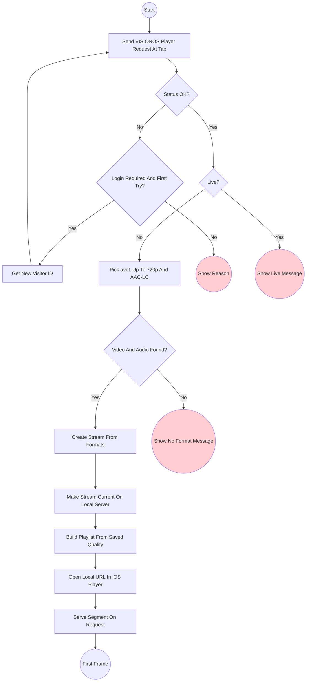

# DUC-PLAY-START: Start Playback

---

## Brief Description

PadTube gets the playable formats of one video from the VISIONOS player request, picks H.264 (avc1, height ≤ 720) and AAC-LC formats, and serves them to the iOS 6 player as local HLS on 127.0.0.1. Each DASH fragment becomes one MPEG-TS segment, fetched with one range request only when the player asks for it. Default quality is 720p; the person's last choice is saved ([D16](../../../decisions.md)).

---

## Entity Definition

See **[tb_player](../../../architecture/domains/padtube-core.md#tb_player)** and **[tb_stream](../../../architecture/domains/padtube-core.md#tb_stream)** in the domain model.

**Key fields for this use case:**
- `status`, `reason`: playability from YouTube (`OK`, `LOGIN_REQUIRED`, `UNPLAYABLE`, `ERROR`, …).
- `f[]` (`tb_format`): `itag`, `url`, `mime`, `height`, `bitrate`, `index_end`, `content_length`, `audio_default`.
- `live`, `hls_url`, `length_s`, `expires_s`.
- `start_at` (input, seconds): resume position from [DUC-HIST-RECORD](../history/record.md).
- `quality` (input): saved choice; default 720. 0 = Auto, else a height.

---

## Actors

| Actor | Type | Description |
|-------|------|-------------|
| **Owner** | Primary | Taps a video, or changes quality or position |
| **Playback Service** | System | Player request, format choice, remux, local HLS server |
| **iOS Player** | System | MPMoviePlayerController; reads the local HLS URL |
| **YouTube** | External | VISIONOS player answer; media bytes from googlevideo |

---

## Preconditions

1. The visitor ID is known (cached; fetched once if missing).
2. The local HLS server listens on 127.0.0.1 (started at app launch).

---

## Postconditions

### Success

1. The iOS player shows the first frame and plays.
2. The local HLS server holds the new stream as its current stream; the old stream is released.
3. The first-frame time (`startMs`) is in the app log.

### Failure

1. The player area shows a message (reason text or a fixed text).
2. No stream is current.

---

## Flows

### Flow Diagram



### Main Success Flow

| Step | Component | Action | Details |
|------|-----------|--------|---------|
| **1** | **Playback Service** | Send Player Request | • Starts at the tap, before the watch view exists<br>• VISIONOS client 1.02, VISIONOS User-Agent, `X-Goog-Visitor-Id`<br>• Field mask on `playabilityStatus`, `streamingData`, `captions`, `videoDetails` |
| **2** | **Playback Service** | Check Status | • `OK` continues; else see EF-PLAY-1, EF-PLAY-2 |
| **3** | **Playback Service** | Pick Formats | • Video: `avc1`, height ≤ 720, one format per height (lowest bitrate), ascending<br>• Audio: `mp4a.40.2`; the default audio track |
| **4** | **Playback Service** | Create Stream | • Copies the formats; no download yet |
| **5** | **HLS Server** | Make Stream Current | • New generation number in the URLs<br>• Old stream released; the swap never blocks the main thread ([D12](../../../decisions.md)) |
| **6** | **HLS Server** | Build Playlists | • Fixed quality (default 720p): one media playlist; the height or the highest one below it<br>• Auto: master playlist from 720p down, 720p first<br>• Playlists come from the sidx index only (no media download) |
| **7** | **iOS Player** | Open URL | • `http://127.0.0.1:<port>/<gen>/master.m3u8` (or `<vi>.m3u8`)<br>• Initial time = `start_at` when > 0 |
| **8** | **Playback Service** | Serve Segment | • First use of a variant: fetch init + sidx (bytes 0..index_end)<br>• Fetch the video fragment of the segment<br>• Fetch the first 8 KB of the audio fragment (moof), then only the bytes up to the last needed sample ([D6](../../../decisions.md))<br>• Remux to one TS segment (H.264 Annex B + AAC ADTS)<br>• Keep it in the segment cache<br>• Start a background prefetch of the next segment |
| **9** | **iOS Player** | First Frame | • The view records `startMs` = tap to first frame |

### Alternative Flows

#### AF1: Change quality
**Trigger:** The owner picks Auto or a height.
- The service makes the same stream current again with the new variant order and opens the player at the current time.

#### AF2: Seek
**Trigger:** The owner seeks.
- The player asks for another segment. The service stops a prefetch of a different segment, so this request does not wait ([tb_stream.c](../../../../core/tb_stream.c) `get_locked`).

#### AF3: Resume
**Trigger:** `start_at` > 0 (see BR-HISTORY-RESUME).
- Step 7 sets the initial time.

#### AF4: Background and return (owner 2026-11-12)
**Trigger:** The owner presses the home button, opens another app, or locks the iPad while a video plays.
- The player keeps the owner's intent (play or pause), not the state that MediaPlayer reports at "resign active" (MediaPlayer pauses itself before that notice).
- In the background: play the same video item on (sound only, no screen); if it does not play after 1 s, switch to the audio-only playlist from the same time. Drop the images that no view shows.
- At return: if the video item played on, seek in place (the video renderer waits for the next keyframe otherwise: black picture); after the audio-only playlist, start the video again from the same time with the thumbnail over the player until the first frame.
- An alarm or a call pauses; when it ends with "should resume", play on. Headphones out pauses (the sound does not move to the speaker).

### Exception Flows

#### EF-PLAY-1: Bot check

**Trigger:** `status` = `LOGIN_REQUIRED` on the first try.

| Step | Component | Action | Details |
|------|-----------|--------|---------|
| **2a** | **Playback Service** | Retry once | • Deletes the cached visitor ID, gets a new one, sends Step 1 again ([research-features §4.1](../../../research/research-features.md#41-watch-video-quality-seek))<br>• A second `LOGIN_REQUIRED` goes to EF-PLAY-2 |

#### EF-PLAY-2: Not playable

**Trigger:** `status` is not `OK` (for example "Made for kids" on VISIONOS, members only, removed).

| Step | Component | Action | Details |
|------|-----------|--------|---------|
| **2b** | **UI** | Show reason | • Shows `reason`, or "This video cannot play (<status>)." |

#### EF-PLAY-3: No H.264 or AAC format

**Trigger:** Step 3 finds no avc1 ≤ 720 format or no AAC-LC format (for example an AV1-only upload).

| Step | Component | Action | Details |
|------|-----------|--------|---------|
| **3a** | **UI** | Show message | • "No H.264 / AAC format for this video." |

#### EF-PLAY-4: Live stream

**Trigger:** `live` = 1.

| Step | Component | Action | Details |
|------|-----------|--------|---------|
| **2c** | **UI** | Play the manifest | • With `hls_url`: the iOS player reads the YouTube HLS manifest directly (no local remux).<br>• Without it: show "This live stream has no HLS manifest." |

#### EF-PLAY-5: Player error

**Trigger:** The iOS player ends with an error.

| Step | Component | Action | Details |
|------|-----------|--------|---------|
| **9a** | **UI** | Show message | • "Playback failed." and the error text |

---

## Business Rules

### Field Rules

| Field | Rule | Description | Enforcement |
|-------|------|-------------|-------------|
| **f[].mime** | BR-PLAY-FORMAT | Keep only `avc1` video with height ≤ 720 and `mp4a.40.2` (AAC-LC) audio. No VP9, AV1, Opus, HE-AAC, 1080p. One video format per height. 360p = itag 134, audio = itag 140 on test video `dQw4w9WgXcQ`. | Step 3 |
| **quality** | BR-PLAY-START | Default 720p. A picked quality is saved and used for the next videos. Auto = master playlist from 720p down, 720p first ([D16](../../../decisions.md), replaces D7). | Step 6 |

### Entity Rules

| Rule | Description | Enforcement |
|------|-------------|-------------|
| **BR-PLAY-REMUX** | 1 DASH fragment = 1 TS segment. Each fragment starts with a keyframe (38/38 measured). Audio frames go to the segment whose time range holds their DTS; segment 0 starts at minus infinity, so each audio frame is in exactly one segment ([D5](../../../decisions.md)). Every segment decodes with no error (ffmpeg) and has the streams `h264` + `aac`. | Step 8 |
| **BR-PLAY-ONE** | One current stream on the local server. A request with an old generation gets HTTP 404. | Step 5 |
| **BR-PLAY-NOJS** | No JavaScript at play time. VISIONOS URLs need no cipher and no `n=` ([research-features §2 F1](../../../research/research-features.md#2-facts-for-2026-that-set-the-design)). | Step 1 |
| **BR-PLAY-CACHE** | Segment cache ≤ 4 remuxed segments (≤ 3.5 MB at 720p). At most one background prefetch at a time. | Step 8 |
| **BR-PLAY-BG-INTENT** | Background play follows the owner's intent, not the player state at "resign active" (AF4). | AF4 |
| **BR-PLAY-BG-PICTURE** | At return from the background the picture shows without waiting for the next keyframe (seek in place, or thumbnail until the first frame) (AF4). | AF4 |

---

## Data Requirements

### Input Data

| Field | Type | Required | Validation | Example |
|-------|------|----------|------------|---------|
| video_id | String | Yes | 11 characters | "dQw4w9WgXcQ" |
| start_at | Double (s) | No | ≥ 0 | 42.5 |
| quality | Int | No | 0 or an available height | 0 |

### Output Data

**Local HLS master playlist (Auto):**
```
#EXTM3U
#EXT-X-STREAM-INF:BANDWIDTH=…,RESOLUTION=1280x720
4.m3u8
#EXT-X-STREAM-INF:BANDWIDTH=…,RESOLUTION=854x480
3.m3u8
#EXT-X-STREAM-INF:BANDWIDTH=…,RESOLUTION=640x360
2.m3u8
#EXT-X-STREAM-INF:BANDWIDTH=…,RESOLUTION=426x240
1.m3u8
```

---

## Acceptance Criteria

### Functional

| AC | Description |
|----|-------------|
| **AC-WATCH-1** | Player for `dQw4w9WgXcQ` gives status `OK`, length > 200 s, 2+ caption tracks, itag 134 and itag 140. Three segments of variant 0 remux to TS that ffmpeg decodes with no error, with streams `aac` and `h264`. Test: `tests/e2e/test_youtube.c` `test_player_and_stream`. |
| **AC-PLAY-2** | On fixtures, the media playlist lists one segment per fragment, every segment decodes, and every audio frame appears once. Tests: `tests/host/test_media.c` (BR-PLAY-REMUX). |
| **AC-PLAY-3** | Through the local server, ffmpeg follows master → media playlist → all segments and decodes every frame; the master lists the start variant first; a stale generation gets 404. Test: `test_hls_server_plays_in_ffmpeg` (BR-PLAY-START). |

### Non-Functional

| AC | Description |
|----|-------------|
| **AC-PLAY-4** | Tap to first frame ≤ 2.5 s at the default quality (720p) on the owner's Wi-Fi, for any video length (3 min and ≥ 45 min). Media bytes before the first frame do not grow with the length. Measured on the iPad, see `docs/STATUS.md` (`tests/device/start_long.py`). |
| **AC-PLAY-6** | A seek far ahead fetches only the target segment (no download of the middle). |
| **AC-PLAY-7** | Full screen turns the interface to landscape; leaving full screen gives back the orientation from before (owner request 2026-11-11, [D17](../../../decisions.md)). |
| **AC-BG-1** | Home button with a video playing: the clock moves 5.0 s per 5 s in the background for 30 s and 120 s, the video item plays on, no main stall > 50 ms from 1 s after return (`tests/device/bg_resume.py`). Lock button: same, run by the owner (no unlock from the Mac). |
| **AC-BG-2** | At return, the first screenshot with PadTube in front shows the picture, not black (`bg_resume.py`, front check against a reference shot). |
| **AC-BG-3** | PadTube in the background with PadBook in front for 10 min: no sound gap, 0 memory warnings, 0 kills (`tests/device/joint_padbook.py`). |
| **AC-PLAY-5** | Remux CPU ≤ 0.10 CPU-s per s of video at 480p; no main-thread stall > 50 ms during playback (G6). |

---

## Supports Business UCs

- [Watch a Video](../../business/watch-a-video.md) – Steps 7 and 9 (start, quality, seek)

---

## Related Domain UCs

- [DUC-CAP-SHOW: Show Captions](../captions/show.md) – uses the caption tracks from the same player answer
- [DUC-HIST-RECORD: Record History](../history/record.md) – gives `start_at`; records the video when the player answer arrives
- [DUC-VPAGE-LOAD: Load the Watch Page](../video-page/load.md) – runs in parallel from the same tap

---

## References

- **Domain Model:** [padtube-core.md](../../../architecture/domains/padtube-core.md) – tb_player, tb_stream, stream/remux and HLS components
- **Code contract:** `core/tb_yt.h` `tb_yt_player`; `core/tb_stream.h`; `core/tb_hls.h`; `core/tb_mp4.h`; `core/tb_ts.h`
- **Research:** [research-features §4.1](../../../research/research-features.md#41-watch-video-quality-seek); [research-efficiency §4](../../../research/research-efficiency.md#4-video-path)
