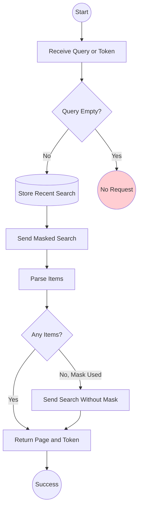

# DUC-SEARCH-SEARCH: Search Videos

---

## Brief Description

PadTube sends one text query (or one continuation token) to YouTube and returns one page of result items with the token for the next page. The same aggregate also gives search suggestions and keeps recent searches.

---

## Entity Definition

See **[tb_list](../../../architecture/domains/padtube-core.md#tb_list)** and **[tb_item](../../../architecture/domains/padtube-core.md#tb_item)** in the domain model.

**Key fields for this use case:**
- `query` (required on page 1): the text the owner sent.
- `continuation` (required on page 2+): token from the previous page.
- `items[]`: video, channel, playlist, live or shelf items with `id`, `title`, `byline`, `length`, `views`, `published`, `thumb`.

---

## Actors

| Actor | Type | Description |
|-------|------|-------------|
| **Owner** | Primary | Sends the query or scrolls to the end of the list |
| **Search Service** | System | Builds the request, parses the answer, keeps recent searches |
| **YouTube** | External | Answers search and suggestion requests (MWEB client) |

---

## Preconditions

1. The visitor ID is known (cached in the state folder, or fetched once).
2. For page 2+, the previous page gave a continuation token.

---

## Postconditions

### Success

1. The owner sees one page of items, and the list can get the next page.
2. The query is at the top of the recent searches (page 1 only).

### Failure

1. The list shows an empty-list message, or the error text.
2. The previous list stays on screen.

---

## Flows

### Flow Diagram



### Main Success Flow

| Step | Component | Action | Details |
|------|-----------|--------|---------|
| **1** | **Search Service** | Receive Query | • Input: `query` (page 1) or `continuation` (page 2+)<br>• Optional `params` (search filter, for example channel-only `EgIQAg==`) |
| **2** | **Search Service** | Validate | • An empty query does not start a request (EF-SEARCH-1) |
| **3** | **Local Store** | Store Recent Search | • Adds the query or moves it to the top (one transaction) |
| **4** | **Search Service** | Send Search | • MWEB client, `prettyPrint=false`, field mask, gzip, kept-alive connection<br>• Page 1 and continuation use different masks |
| **5** | **Search Service** | Parse Items | • yyjson in situ<br>• Maps each renderer to one `tb_item` kind: video, channel, playlist, live, shelf |
| **6** | **Search Service** | Return Page | • Returns `tb_list` with `items` and `continuation`<br>• The UI appends the page and starts the thumbnail loads off the main thread |

### Alternative Flows

#### AF1: Mask gives no items
**Trigger:** Step 5 – the masked answer has zero items (YouTube changed a layout).
- 5a. The service sends the same search without a mask ([D10](../../../decisions.md)).
- 5b. Continue at Step 6.

#### AF2: Suggestions
**Trigger:** The owner types in the search field.
- Empty field: the UI shows the recent searches, newest first (AC-SEARCH-3).
- Text: the service sends `GET suggestqueries.google.com/complete/search?client=firefox&ds=yt&q=<text>` and returns a list of strings (AC-SEARCH-2).

### Exception Flows

#### EF-SEARCH-1: Empty query

**Trigger:** The query has no characters.

| Step | Component | Action | Details |
|------|-----------|--------|---------|
| **2a** | **Search Service** | Stop | • No request; the list does not change |

#### EF-SEARCH-2: No results

**Trigger:** YouTube returns zero items with and without the mask.

| Step | Component | Action | Details |
|------|-----------|--------|---------|
| **6a** | **UI** | Show empty text | • Shows the list empty-text message |

---

## Business Rules

### Field Rules

| Field | Rule | Description | Enforcement |
|-------|------|-------------|-------------|
| **thumb** | BR-SEARCH-THUMB | Video thumbnails use `mqdefault.jpg` (320x180, 10–25 KB). No WebP, no `hqdefault` ([research-efficiency §5](../../../research/research-efficiency.md#5-ui-smoothness-on-ios-6--a5)). | Step 5 |
| **id** | BR-SEARCH-ID | A video item has an 11-character video ID. | Step 5 |

### Entity Rules

| Rule | Description | Enforcement |
|------|-------------|-------------|
| **BR-NET-MASK** | Search uses a field mask. A masked page 1 of 10+ videos is less than 14,000 B decoded (measured on the Mac 2026-11-11: 10.9 KB decoded, 2.4 KB gzip; 160 KB unmasked). No protobuf ([research-efficiency §1.2](../../../research/research-efficiency.md#12-field-masks-gzip-and-protobuf-measured-host-youtubeigoogleapiscom-mweb-search)). | Step 4; test `test_search_masked` |
| **BR-SEARCH-RECENT** | Recent searches: newest first, one row per query; a repeat moves the query to the top. | Step 3 |
| **BR-SEARCH-NO-AVATAR** | No channel avatar per result row; the mask leaves `channelThumbnail` out ([research-efficiency §9](../../../research/research-efficiency.md#9-features-to-cut-or-limit-for-smoothness)). | Step 4 |

---

## Data Requirements

### Input Data

| Field | Type | Required | Validation | Example |
|-------|------|----------|------------|---------|
| query | String | Page 1 | Not empty | "lofi music" |
| continuation | String | Page 2+ | Token from previous page | "EpcDEgpsb2Zp…" |
| params | String | No | Base64 SearchFilter | "EgIQAg==" |

### Output Data

**tb_list (one page):**
```json
{
  "items": [{"kind": 1, "id": "dQw4w9WgXcQ", "title": "Never Gonna Give You Up", "byline": "Rick Astley",
             "length": "3:34", "views": "… views", "published": "… years ago",
             "thumb": "https://i.ytimg.com/vi/dQw4w9WgXcQ/mqdefault.jpg"}],
  "continuation": "EpcDEgpsb2Zp…"
}
```

---

## Acceptance Criteria

### Functional

| AC | Description |
|----|-------------|
| **AC-SEARCH-1** | Search "lofi music" returns 10+ items with a continuation; 10+ items are videos with an 11-character ID, a title and an `mqdefault.jpg` thumbnail; the continuation returns 10+ more items. Test: `tests/e2e/test_youtube.c` `test_search_masked`. |
| **AC-SEARCH-2** | Suggestions for "never gonna" return 3 or more strings. Test: `test_suggest`. |
| **AC-SEARCH-3** | Recent searches "one", "two", "one" list as ["one", "two"]: newest first, no duplicate. Test: `tests/host/test_store.c` `test_store_searches_and_kv`. |

### Non-Functional

| AC | Description |
|----|-------------|
| **AC-SEARCH-4** | Tap to first results drawn ≤ 1.2 s on the iPad (G2). Measured on the iPad, see `docs/STATUS.md`. |
| **AC-SEARCH-5** | Parse and list update do not stall the main thread > 50 ms (G6). |

---

## Supports Business UCs

- [Watch a Video](../../business/watch-a-video.md) – Steps 1–4 (find the video)

---

## Related Domain UCs

- [DUC-VPAGE-LOAD: Load the Watch Page](../video-page/load.md) – the owner taps a result
- [DUC-LIB-BROWSE: Browse a List](../library/browse.md) – same `tb_list` shape for other lists

---

## References

- **Domain Model:** [padtube-core.md](../../../architecture/domains/padtube-core.md) – tb_list, tb_item, innertube component
- **Code contract:** `core/tb_yt.h` `tb_yt_search`, `tb_yt_suggest`; `core/tb_store.h` `tb_store_search_add`, `tb_store_search_list`
- **Research:** [research-features §4.5](../../../research/research-features.md#45-search); [research-efficiency §1.2](../../../research/research-efficiency.md#12-field-masks-gzip-and-protobuf-measured-host-youtubeigoogleapiscom-mweb-search)
