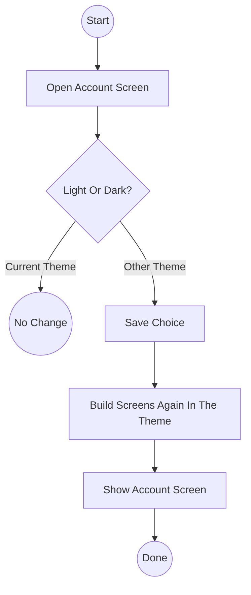

# DUC-SET-THEME: Set Theme

---

## Brief Description

The owner picks Light or Dark on the Account screen. PadTube saves the choice, draws every screen again in the picked theme, and starts in it the next time. Both themes keep the 2012 YouTube-for-iPad look ([design §14](../../../design/old-youtube-ui.md#14-dark-theme-owner-2026-11-12)).

---

## Entity Definition

No core entity. The choice is one app setting: `TBDark` (bool) in the app defaults. Default: Light (the 2012 look).

---

## Actors

| Actor | Type | Description |
|-------|------|-------------|
| **Owner** | Primary | Picks Light or Dark |
| **UI** | System | Saves the choice and rebuilds the screens |

---

## Preconditions

1. PadTube runs. Sign-in is not needed.

---

## Postconditions

### Success

1. Every screen (guide, header, lists, cards, watch page, comments, channel, account, sign-in, search suggestions) shows the picked theme.
2. The choice stays after the app quits.

### Failure

1. None: the choice is a local setting.

---

## Flows

### Flow Diagram

### Main Success Flow

| Step | Component | Action | Details |
|------|-----------|--------|---------|
| **1** | **UI** | Show Theme Control | • Account screen: "Theme" with two segments, Light and Dark; the current one is selected |
| **2** | **UI** | Save Choice | • `TBDark` = YES or NO in the app defaults |
| **3** | **UI** | Build Screens Again | • Clear the drawn-image cache; make a new root (guide, header, navigation stack) with the theme colours • The Account screen shows again |

### Alternative Flows

#### AF1: A video plays while the owner changes the theme
**Trigger:** The owner opens Account from the guide while the sound plays.
- The rebuild closes the watch page; the video stops. The owner opens it again (history keeps the position).

---

## Business Rules

### Entity Rules

| Rule | Description | Enforcement |
|------|-------------|-------------|
| **BR-THEME-STYLE** | Dark keeps the 2012 shapes: the same bars, guide, cards, segments, red bar; only the light areas (content, cards, buttons, info pane, suggestions) take dark tones. | Step 3 |
| **BR-THEME-ONE-PLACE** | All theme colours and drawn images come from `TBStyle`; no view keeps its own light colour. | Step 3 |
| **BR-THEME-FAST** | The theme adds no run-time cost: opaque views, drawn images cached once per theme. | Step 3 |
| **BR-THEME-QR** | The sign-in QR code stays black on white in both themes (phone cameras need it). | Step 3 |

---

## Acceptance Criteria

### Functional

| AC | Description |
|----|-------------|
| **AC-THEME-1** | On the iPad each screen in Dark and in Light, portrait and landscape, has no light patch in Dark, no unreadable text, no icon that vanishes, no stray line, no clipped text. Screenshots checked by eye: `tests/artifacts/device/theme_*.png`, table in STATUS. Test: `tests/device/theme_audit.py`. |
| **AC-THEME-2** | The choice stays after the app quits (relaunch shows the same theme). |

### Non-Functional

| AC | Description |
|----|-------------|
| **AC-THEME-3** | In Dark: scroll >= 55 fps, RAM steady <= 120 MB, no main stall > 50 ms in scroll (G1, G4, G6). |

---

## Related Domain UCs

- [DUC-ACCT-SIGN-IN](../account/sign-in.md) – the same Account screen

---

## References

- **Design:** [old-youtube-ui.md §14](../../../design/old-youtube-ui.md#14-dark-theme-owner-2026-11-12)
- **Decision:** [D39](../../../decisions.md)
- **Code contract:** `ios/src/TBStyle.h` `+dark`, `+setDark:`
