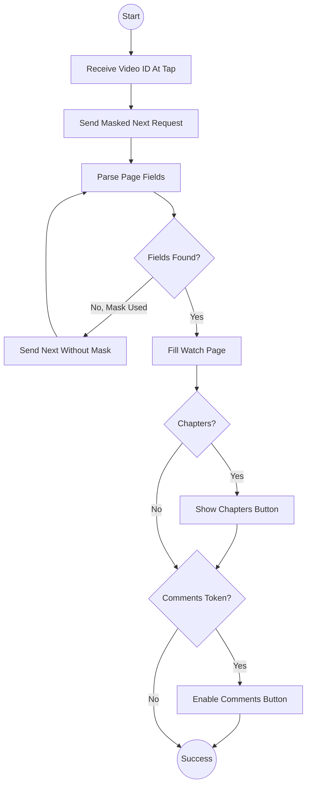

# DUC-VPAGE-LOAD: Load the Watch Page

---

## Brief Description

At the tap on a video, PadTube sends the MWEB `next` request in parallel with the player request. The answer fills the watch page: title, channel, likes, description, chapters, related videos and the comments token. Comments load only when the owner opens them.

---

## Entity Definition

See **[tb_next](../../../architecture/domains/padtube-core.md#tb_next)** and **[tb_comments](../../../architecture/domains/padtube-core.md#tb_comments)** in the domain model.

**Key fields for this use case:**
- `title`, `views`, `date`, `description`.
- `channel`, `channel_id`, `channel_thumb`, `subscribers`, `subscribed` (-1 unknown).
- `likes`.
- `related` (`tb_list`), `chapters[]` (`start`, `title`), `comments_token`, `comment_count`.

---

## Actors

| Actor | Type | Description |
|-------|------|-------------|
| **Owner** | Primary | Taps a video; reads the page; opens chapters or comments |
| **Video Page Service** | System | Sends `next`, parses the page, loads comments on demand |
| **YouTube** | External | InnerTube `next` (MWEB) |

---

## Preconditions

1. The owner tapped a video ID.

---

## Postconditions

### Success

1. The watch page shows title, views and date, channel and subscribers, Like button with the count, description and related videos.
2. The Chapters button shows only when chapters exist.
3. The Comments button is active only when a comments token exists.

### Failure

1. The page shows the title from the list row and no extra data. The video still plays.

---

## Flows

### Flow Diagram



### Main Success Flow

| Step | Component | Action | Details |
|------|-----------|--------|---------|
| **1** | **Video Page Service** | Send Next | • At the tap, in parallel with the player request ([DUC-PLAY-START](../playback/start.md))<br>• MWEB client, field mask, gzip ([D15](../../../decisions.md)) |
| **2** | **Video Page Service** | Parse | • Title, views, date, description, channel fields, likes, subscribed state<br>• Related videos as `tb_list`<br>• Chapters from the player overlay chapter markers (`chapterRenderer`: title, start in ms → seconds)<br>• Comments token and count |
| **3** | **UI** | Fill Page | • Meta line "views · date"; channel line "channel · N subscribers"; "Like N" |
| **4** | **UI** | Chapters and Comments | • Chapters button hidden when `nchapters` = 0<br>• Comments button disabled when no token |

### Alternative Flows

#### AF1: Mask gives no fields
**Trigger:** Step 2 finds nothing in the masked answer.
- The service sends `next` again without a mask ([D15](../../../decisions.md)).

#### AF2: Open comments
**Trigger:** The owner taps Comments.
- A new screen sends `next` with the comments token and shows author, text, date, likes, reply count; it pages with the continuation. Replies open the same screen with the reply token ([research-efficiency §9](../../../research/research-efficiency.md#9-features-to-cut-or-limit-for-smoothness)).

#### AF3: Pick a chapter
**Trigger:** The owner taps a chapter.
- The player seeks to the chapter start.

#### AF4: Like or subscribe (signed in)
**Trigger:** The owner taps Like or Subscribe.
- TVHTML5 with the token: `like/like`, `like/dislike`, `like/removelike`, or subscribe / unsubscribe by channel ID. The button text changes when the call succeeds.

### Exception Flows

#### EF-VPAGE-1: Like or subscribe while signed out

| Step | Component | Action | Details |
|------|-----------|--------|---------|
| **AF4a** | **UI** | Ask to sign in | • Alert "Sign in (Account in the guide) to …"; no request |

---

## Business Rules

### Entity Rules

| Rule | Description | Enforcement |
|------|-------------|-------------|
| **BR-VPAGE-PARALLEL** | `next` and `player` start at the tap, before the watch view exists. | Step 1 |
| **BR-NET-MASK** | `next` uses a field mask with a no-mask fallback ([D15](../../../decisions.md): 44 KB → 4.9 KB gzip on `aircAruvnKk`, measured on the Mac). | Step 1, AF1 |
| **BR-VPAGE-COMMENTS** | Comments load only on tap, on their own screen; no live chat. | AF2 |
| **BR-LOGIN-TV** | Like and subscribe use TVHTML5 with the token. | AF4 |

---

## Data Requirements

### Input Data

| Field | Type | Required | Validation | Example |
|-------|------|----------|------------|---------|
| video_id | String | Yes | 11 characters | "aircAruvnKk" |

### Output Data

**tb_next:**
```json
{"title": "But what is a neural network? | Deep learning chapter 1", "channel": "3Blue1Brown",
 "channel_id": "UCYO_jab_esuFRV4b17AJtAw", "views": "… views", "likes": "…",
 "chapters": [{"start": 0, "title": "…"}, {"start": "> 0", "title": "…"}],
 "related": {"items": ["…"]}, "comments_token": "Eg0SC2FpcmNBcnV2bktr…"}
```

---

## Acceptance Criteria

### Functional

| AC | Description |
|----|-------------|
| **AC-WATCH-2** | `next` for `aircAruvnKk`: title has "neural network", channel "3Blue1Brown", channel ID `UCYO_jab_esuFRV4b17AJtAw`, views text has "views", description > 50 characters, likes not empty, comments token present, 5+ related items. Test: `tests/e2e/test_youtube.c` `test_next_watch_page`. |
| **AC-CHAPTERS-1** | Same video: 5+ chapters; chapter 0 starts at 0; chapter 1 starts after 0. Test: `test_next_watch_page`. |
| **AC-COMMENTS-1** | The comments token gives 10+ comments, each with author and text, and a continuation. Test: `test_next_watch_page`. |
| **AC-VPAGE-3** | Signed in: Like and Subscribe change state on YouTube and on the button. Open: real account test. |

### Non-Functional

| AC | Description |
|----|-------------|
| **AC-VPAGE-4** | The page fill does not stall the main thread > 50 ms (G6) and does not delay the first frame (G3). |

---

## Supports Business UCs

- [Watch a Video](../../business/watch-a-video.md) – Step 6, Alternative Flows 3 and 4

---

## Related Domain UCs

- [DUC-PLAY-START: Start Playback](../playback/start.md) – runs in parallel from the same tap
- [DUC-LIB-BROWSE: Browse a List](../library/browse.md) – channel page from the channel line

---

## References

- **Domain Model:** [padtube-core.md](../../../architecture/domains/padtube-core.md) – tb_next, tb_comments
- **Code contract:** `core/tb_yt.h` `tb_yt_next`, `tb_yt_comments`, `tb_yt_like`, `tb_yt_subscribe`; `ios/src/TBWatchController.h`, `ios/src/TBCommentsController.h`
- **Research:** [research-features §4.10, §5.3](../../../research/research-features.md#410-like-and-subscribe)
